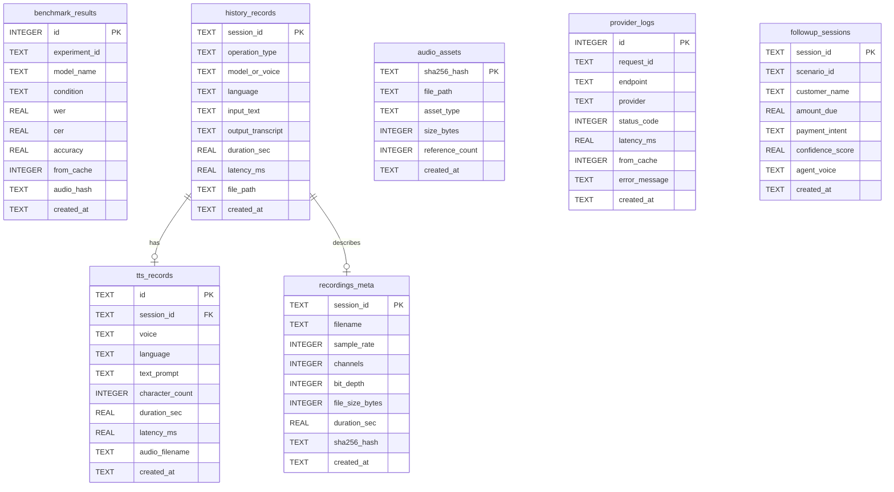

# CallLens — Data Architecture, Schemas & Storage Management

**Document ID:** `CL-DATA-001`  
**Version:** 2.0.0  
**Status:** Canonical Reference  
**Last Updated:** November 2026  
**Author:** Technical Ownership & Engineering Governance  

---

## 1. Storage Topology & Persistence Strategy

All persistent data generated and utilized by CallLens resides in an externalized dedicated data directory:
- **Base Data Path:** `E:\Gnani AI proj\calllens-data\`
- **Database File:** `E:\Gnani AI proj\calllens-data\benchmark.db`
- **Recordings Store:** `E:\Gnani AI proj\calllens-data\recordings\`
- **TTS Audio Store:** `E:\Gnani AI proj\calllens-data\tts_audio\`
- **Temporary Scratch Space:** `E:\Gnani AI proj\calllens-data\temp\`
- **Accounting State:** `E:\Gnani AI proj\calllens-data\call_accounting.json`

### 1.1. Persistence Across Backend Restarts
Because data and audio files reside in `calllens-data/` completely external to the application codebase:
1. **Zero Data Loss on Restart:** Terminating or restarting Uvicorn processes does not affect database records or audio assets.
2. **Deterministic Re-mounting:** On startup, FastAPI mounts persistent folders as static endpoints, immediately serving existing audio files to the frontend.
3. **Session Reconnection:** Any session ID logged in `benchmark.db` remains queryable and playable across system reboots.

---

## 2. SQLite Database Configuration

CallLens uses an embedded SQLite 3 engine tuned for high-concurrency read/write operations:
- **Journal Mode:** Write-Ahead Logging (`PRAGMA journal_mode=WAL;`). WAL mode allows concurrent readers to operate without being blocked by writers.
- **Synchronous Setting:** `PRAGMA synchronous=NORMAL;`. Optimizes write throughput while ensuring durability against application crashes.
- **Busy Timeout:** `PRAGMA busy_timeout=5000;`. Mitigates `database is locked` errors during burst writes.
- **Foreign Key Constraints:** `PRAGMA foreign_keys=ON;`. Enforces referential integrity.

---

## 3. Database Schemas

The database contains seven core relational tables:



### 3.1. Schema DDL Definitions

#### `benchmark_results` (Immutable Historical Benchmark)
```sql
CREATE TABLE IF NOT EXISTS benchmark_results (
    id INTEGER PRIMARY KEY AUTOINCREMENT,
    experiment_id TEXT NOT NULL,       -- 'A', 'D', or 'F'
    model_name TEXT NOT NULL,          -- 'prisma-v2.5' or 'prisma-v3.0'
    condition TEXT NOT NULL,           -- 'clean', 'telephone', 'telephone_10db', 'telephone_0db'
    wer REAL NOT NULL,                 -- Word Error Rate (percentage)
    cer REAL NOT NULL,                 -- Character Error Rate (percentage)
    accuracy REAL NOT NULL,            -- Word Accuracy (100 - wer)
    from_cache INTEGER DEFAULT 0,      -- 1 = cache hit, 0 = fresh call
    audio_hash TEXT NOT NULL,          -- SHA-256 of source audio
    created_at TIMESTAMP DEFAULT CURRENT_TIMESTAMP
);
CREATE INDEX IF NOT EXISTS idx_bench_model_cond ON benchmark_results (model_name, condition);
```

#### `history_records` (Session Audit Log)
```sql
CREATE TABLE IF NOT EXISTS history_records (
    session_id TEXT PRIMARY KEY,       -- UUID or formatted timestamp
    operation_type TEXT NOT NULL,      -- 'stt', 'tts', 'websocket', 'stress'
    model_or_voice TEXT NOT NULL,      -- Engine or Voice name used
    language TEXT NOT NULL,            -- 'en-IN', 'hi-IN', etc.
    input_text TEXT,                   -- Text prompt for TTS or reference text
    output_transcript TEXT,            -- Transcribed speech for STT
    duration_sec REAL NOT NULL,        -- Audio duration
    latency_ms REAL NOT NULL,          -- Execution wall-clock time
    file_path TEXT,                    -- Relative path to audio WAV
    created_at TIMESTAMP DEFAULT CURRENT_TIMESTAMP
);
CREATE INDEX IF NOT EXISTS idx_hist_created ON history_records (created_at DESC);
```

---

## 4. Historical Benchmark Accounting Reconciliation

The exact counts in historical benchmark data are grounded in raw SQLite inspection:
- **Total Historical Benchmark Rows:** Exactly **360** rows in `benchmark_results`.
- **Experiment Breakdown:**
  - **Experiment A (FLEURS Telephony Robustness):** **240 records** (30 FLEURS clips $\times$ 4 conditions $\times$ 2 models = 240 records; all `from_cache = 0`).
  - **Experiment D (Noise & Silence Hallucination):** **40 records** (20 noise clips $\times$ 2 models = 20 fresh records; 10 silence clips $\times$ 2 models = 20 records).
    - `silence_01` (2 models): **2 fresh evaluations** (`from_cache = 0`).
    - `silence_02` through `silence_10` (9 clips $\times$ 2 models): **18 cache hits** (`from_cache = 1`) against the identical SHA-256 hash of `silence_01`.
    - Total Experiment D: 22 fresh (`from_cache = 0`) + 18 cached (`from_cache = 1`) = 40 records.
  - **Experiment F (BFSI Banking Entity Extraction):** **80 records** (10 synthetic utterances $\times$ 4 conditions $\times$ 2 models = 80 records; all `from_cache = 0`).
  - **Total Evaluations:** $240 + 40 + 80 = \mathbf{360}$ records.
- **Cache Hit Distribution in Database:**
  - `from_cache = 0`: **342 records**
  - `from_cache = 1`: **18 records** (the 18 identical silence evaluations in Experiment D)
  - Total: **360 records**

### Reconciling 341 Network Attempts vs 342 Fresh Database Records vs 56 Pipeline Cache Hits
In `app/main.py` and `call_accounting.json`, historical provider calls are recorded as:
- **Total Network Attempts:** **341 attempts** ($338$ successful HTTP requests + $3$ retried Cloudflare HTTP 504 timeouts = $341$).
  - Timeouts occurred on: `fleurs_17` (tel_snr10), `fleurs_24` (tel_snr0), and `bfsi_07` (tel_snr10). All three were recovered on retry attempt 1 (backoff: 1.0s) returning HTTP 200.
- **The 4-Call Probe Difference ($342 - 338 = 4$):** Prior to executing the 360-evaluation benchmark runner, the operational usage probe (`scripts/usage_probe.py`) executed 4 live STT calls against the provider (evaluating probe clips 1 and 2 on clean condition across Prisma v2.5 and v3.0) and saved them to `calllens-data/cache/`. When Experiment A ran, these 4 evaluations were satisfied from the pre-warmed cache, resulting in 338 net fresh calls during the benchmark run ($338 + 4 = 342$ total unique audio evaluations).
- **The 56 Pipeline Cache Hits:** Across the entire multi-stage testing sequence (`usage_probe.py`, `format_pilot.py` (20 calls), `gen_utterances.py` (10 calls), and repeated benchmark validation sweeps), the caching engine intercepted **56 redundant invocations** (including the 18 identical silence evaluations, repeated prompt probes, and format verification steps), avoiding unnecessary cloud spend.

---

## 5. Storage Metrics & Asset Lifecycle

### 5.1. Verified Storage Baseline (Current Runtime)
| Asset Directory | File Count | Size on Disk | Disk Path | Health Status |
| :--- | :--- | :--- | :--- | :--- |
| **Recordings (`recordings/`)** | 217 files | 21.08 MB | `E:\Gnani AI proj\calllens-data\recordings` | Healthy |
| **TTS Audio (`tts_audio/`)** | 130 files | 12.13 MB | `E:\Gnani AI proj\calllens-data\tts_audio` | Healthy |
| **Temp Scratch (`temp/`)** | 0 files | 0.00 MB | `E:\Gnani AI proj\calllens-data\temp` | Clean |
| **Total Audio Assets** | **347 files** | **33.21 MB** | Entire Asset Storage Pool | **100% Synchronized** |

### 5.2. Asset Integrity Verification
The storage diagnostic engine (`calllens/storage_manager.py`) runs periodic consistency checks:
- **Orphaned File Detection:** Scans disk directories and flags any `.wav` file whose path does not exist in `history_records` or `recordings_meta`. Current count: **0**.
- **Missing File Detection:** Scans database records and flags any record whose referenced file is missing from disk. Current count: **0**.

### 5.3. Atomic Cascading Deletion Protocol
When a user deletes a session via `DELETE /api/recordings/{session_id}`:
```
┌─────────────────────────────────────────────────────────────┐
│                 Atomic Deletion Sequence                    │
└──────────────────────────────┬──────────────────────────────┘
                               │
                1. Begin SQLite Transaction
                               │
                2. Fetch file_path from history_records
                               │
                3. DELETE FROM history_records WHERE session_id = ?
                               │
                4. Commit SQLite Transaction
                               │
                5. Check if file exists on disk
                               │
               ┌───────────────┴───────────────┐
              YES                              NO
               │                               │
    6. Unlink file via os.remove()   6. Log warning (DB cleaned)
               │                               │
               └───────────────┬───────────────┘
                               │
                    7. Return 200 OK Response
```
This guarantees that database references are never left pointing to non-existent files.

