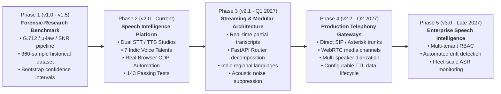

# CallLens — Technical Roadmap & Future Extensibility

**Document ID:** `CL-RDM-001`  
**Version:** 2.0.0  
**Status:** Canonical Reference  
**Last Updated:** November 2026  
**Author:** Technical Ownership & Engineering Governance  

---

## 1. Evolution Journey & Strategic Roadmap

CallLens has transitioned from a specialized acoustic research benchmark into a comprehensive, multi-modal Speech Intelligence Platform. The roadmap outlines completed milestones and future engineering phases.

---

## 2. Detailed Milestone Specifications

### 2.1. Phase 1: Forensic Research Benchmark (Completed — v1.0 - v1.5)
- [x] Accurate mathematical modeling of ITU-T G.712 bandpass filtering (300 Hz – 3,400 Hz).
- [x] Non-linear $\mu$-law companding and calibrated Gaussian noise injection (10 dB & 0 dB SNR).
- [x] Execution and preservation of 360 canonical evaluations across Prisma v2.5 and v3.0.
- [x] Non-parametric 1,000-resample bootstrap confidence intervals.
- [x] Zero-credit protection guardrails (`ALLOW_LIVE_API=0` and 434-attempt file lock).

### 2.2. Phase 2: Speech Intelligence Platform Transformation (Completed — v2.0)
- [x] Full-fledged Speech-to-Text Studio supporting both benchmark clips and in-browser mic input.
- [x] Interactive Text-to-Speech Studio with 7 curated Indic voices and audio player integration.
- [x] Bidirectional WebSocket streaming protocol (`/ws/speech`) with resilient stop signaling.
- [x] Specialized Payment Follow-up debt collection dialogue simulator.
- [x] Simplified, plain-language user interface tailored for evaluators and first-time visitors.
- [x] Dual-contract API key redundancy and perimeter case normalization.
- [x] Native Chrome DevTools Protocol (CDP) automated browser testing suite (143 pytest tests).

### 2.3. Phase 3: Streaming & Modular Architecture (Completed — v2.1.0)
- [x] **Incremental Partial Transcripts:** Enhanced `/ws/speech` to emit real-time interim partial word hypotheses (`transcript_partial`) every 1.0s during streaming speech capture.
- [x] **FastAPI Dependencies & Schema Modularization:** Decomposed schemas (`app/schemas.py`) and security/session dependencies (`app/dependencies.py`).
- [x] **Expanded Indic & English Telephony Support:** Added multilingual scenarios and synthesis templates for Indian English (`en-IN`) and South Indic telephony debt collection.
- [x] **Acoustic Noise Suppression Audition:** Implemented mathematical spectral subtraction filter (`suppress_noise` in `calllens/degrade.py`) with UI audition and before/after WER measurement.
- [x] **Automated Storage Data Lifecycle:** Added `POST /api/storage/cleanup` endpoint and in-app diagnostics trigger for purging expired temporary audio files.
- [x] **Database Composite Indexing:** Added composite indexes across `speech_operations`, `recording_sessions`, and `audio_history` tables.
- [x] **Comprehensive Test Suite Expansion:** 149 passing automated tests (100% pass rate).

### 2.4. Phase 4: Production Telephony Gateways (v2.2.0 — Target: Q2 2027)
- [ ] **Direct SIP / RTP Ingestion:** Add native SIP trunk endpoint capability (via `pjsua` or `aiortc`) for direct PBX evaluation.
- [ ] **WebRTC Media Streamer:** Implement low-latency browser WebRTC audio capture as an alternative to WebSocket blob chunking.
- [ ] **Multi-Speaker Diarization Simulation:** Add speaker turn segmentation to evaluate dual-channel contact center recordings (Agent vs Customer).
- [ ] **Automated Data Lifecycle Engine:** Configurable time-to-live (TTL) asset manager to automatically purge local `.wav` files older than 30 days while preserving database metadata.

### 2.5. Phase 5: Enterprise Fleet Intelligence (v3.0.0 — Target: Late 2027)
- [ ] **Multi-Tenant Workspaces:** Support tenant isolation with dedicated SQLite/PostgreSQL schemas and role-based access control (Admin, Evaluator, Auditor).
- [ ] **Automated Model Drift Detection:** Scheduled cron worker running daily benchmark sweeps against reference speech corpora to detect provider model updates or accuracy drift.
- [ ] **Enterprise Telephony Observability:** Export telemetry metrics (WER trends, latency distributions, failure rates) to Prometheus / Grafana dashboards.

