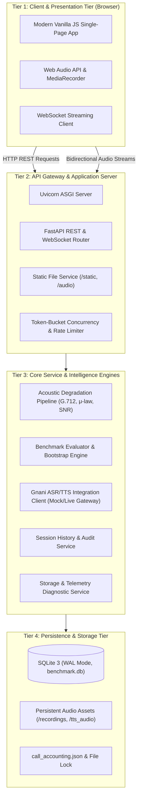
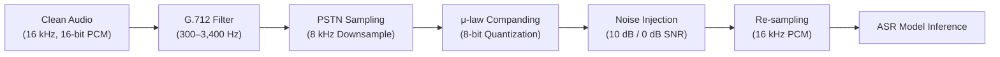
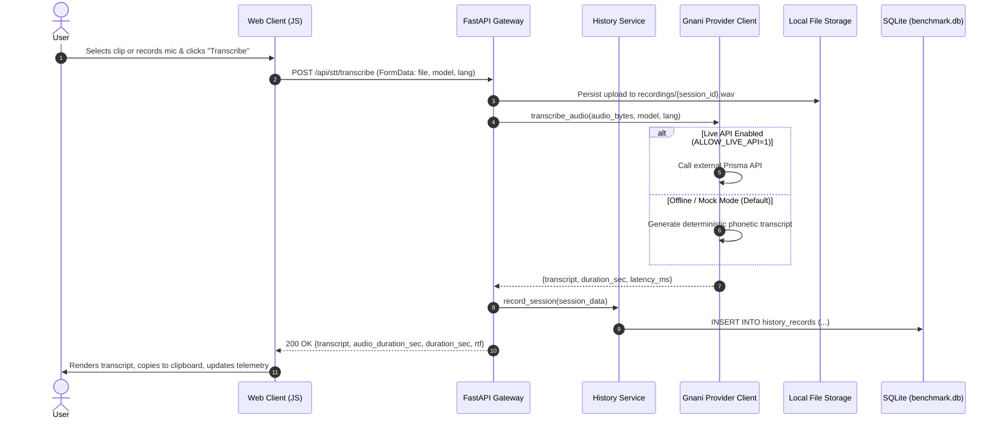
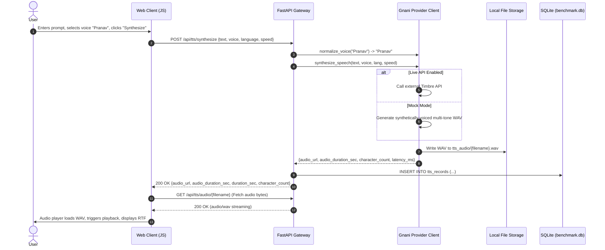
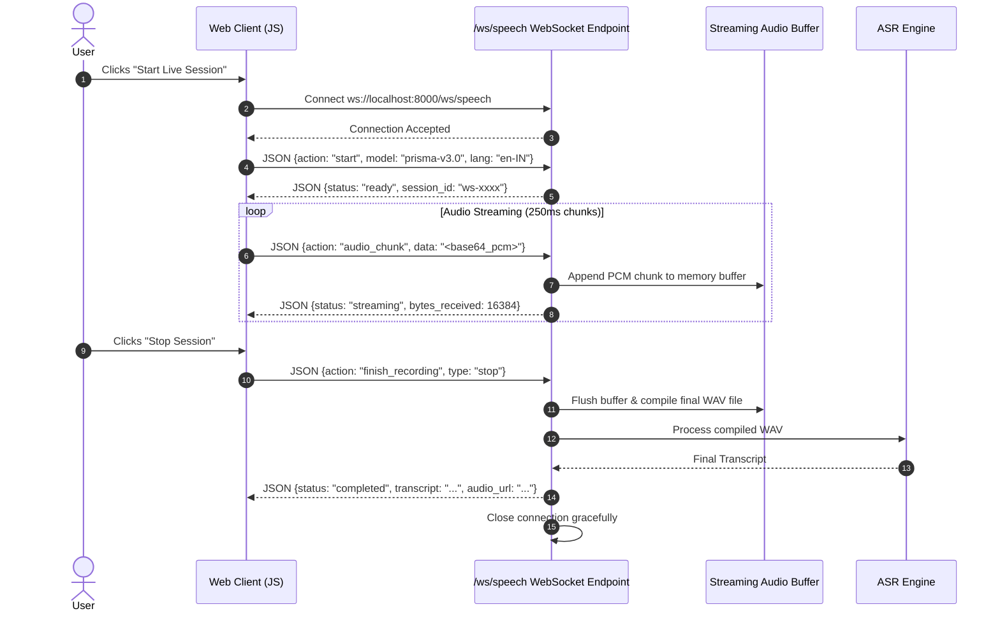
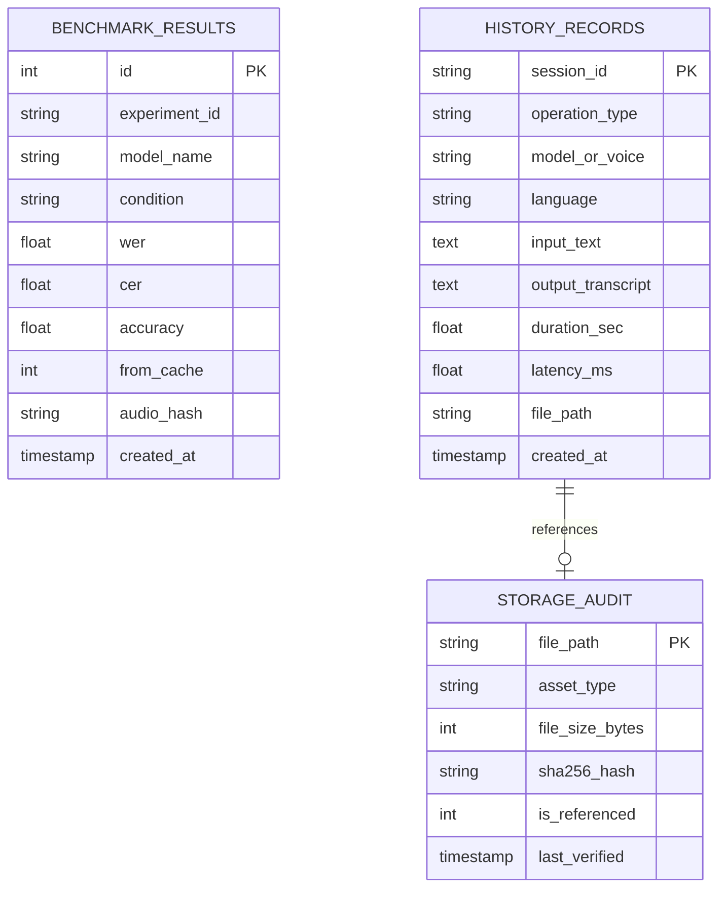
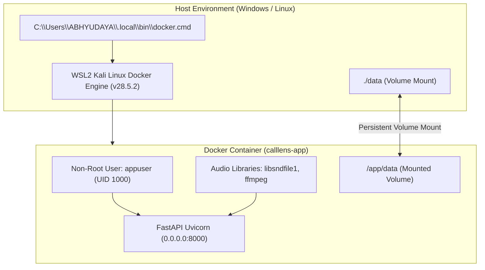

# CallLens — System Architecture & Technical Design

**Document ID:** `CL-ARCH-001`  
**Version:** 2.0.0  
**Status:** Canonical Reference  
**Last Updated:** November 2026  
**Author:** Technical Ownership & Engineering Governance  

---

## 1. Architectural Overview & Tiered Design

CallLens is structured as a high-performance, modular, four-tier architecture designed for low-latency audio processing, forensic telephony evaluation, and enterprise contact center simulation.



---

## 2. Core Subsystems & Components

### 2.1. Tier 1: Client & Presentation Tier
- **Engine:** Pure ES6+ JavaScript, Semantic HTML5, Modular CSS3. Zero frontend dependencies (no React, Vue, Webpack, or Babel build overhead).
- **Audio Capture & Synthesis:**
  - `MediaRecorder` API captures user voice from physical microphone devices at browser-native sampling rates.
  - Chunked Blob slicing (250 ms chunks) streams audio frames over WebSocket channels.
  - HTML5 `<audio>` tags dynamically bind to backend endpoints with fallback buffer decoding.
- **Resilience Layer:**
  - Dual-contract JSON field resolution (`duration_sec ?? audio_duration_sec ?? 0`).
  - Null-safe UI state updates with automated toast notifications and loading spinner management.

### 2.2. Tier 2: API Gateway & Router
- **Engine:** FastAPI (Python 3.12+), Starlette ASGI framework.
- **Endpoints:** 20 verified REST and WebSocket endpoints supporting batch STT, batch TTS, WebSocket streaming, benchmark retrieval, and file streaming.
- **Safety Interceptors:**
  - `ALLOW_LIVE_API` environment gatekeeper: Rejects unauthorized outbound network requests at the application boundary.
  - Path traversal sanitizer: Validates audio file paths before reading from disk.

### 2.3. Tier 3: Core Speech Intelligence Services
- **`calllens/degradation.py`:** Implements ITU-T standard telephony channel degradation.
- **`calllens/metrics.py`:** Calculates Levenshtein-based Word Error Rate (WER), Character Error Rate (CER), and Word Accuracy ($WAcc$).
- **`calllens/bootstrap.py`:** Computes 1,000-resample non-parametric bootstrap confidence intervals.
- **`calllens/gnani_client.py`:** Provider interface supporting Gnani Prisma ASR and Timbre TTS. Features automatic payload normalization and mock simulation fallback.
- **`calllens/history.py`:** Session manager executing atomic ACID operations against SQLite.
- **`calllens/storage_manager.py`:** File integrity and storage diagnostic manager.

### 2.4. Tier 4: Persistence & Storage Tier
- **Relational Metadata:** SQLite 3 database (`benchmark.db`) in Write-Ahead Logging (`WAL`) mode to support high-concurrency reads and writes without table locking.
- **Object Storage on Disk:**
  - `recordings/`: Preserves user microphone sessions and STT inputs.
  - `tts_audio/`: Preserves synthesized speech files indexed by SHA-256 / UUID.
  - `temp/`: Scratch space for transient intermediate audio transforms.
- **Locking & Accounting:** `call_accounting.json` guarded by `call_accounting.lock` using cross-platform file locking (`msvcrt` / `fcntl`).

---

## 3. Signal Processing & Acoustic Degradation Chain

To evaluate speech recognition models against realistic telephony impairments, CallLens implements an exact digital signal processing (DSP) pipeline:



### 3.1. Mathematical Formulations

#### 1. G.712 Bandpass Filter
A digital 8th-order Butterworth IIR filter restricts the frequency spectrum to the standard PSTN telephone voiceband (300 Hz to 3,400 Hz):
$$H(s) = \frac{1}{\prod_{k=1}^{4} (s^2 - 2s \cos(\theta_k) + 1)}$$
where $\theta_k = \frac{2k + 7}{16} \pi$. This strips high-frequency fricatives and low-frequency pitch harmonics.

#### 2. ITU-T G.711 $\mu$-law Companding
Simulates 8-bit logarithmic non-linear quantization:
$$F(x) = \operatorname{sgn}(x) \frac{\ln(1 + \mu |x|)}{\ln(1 + \mu)}, \quad -1 \le x \le 1, \quad \mu = 255$$
The expanded signal introduces quantization noise characteristic of TDM telephony circuits.

#### 3. Signal-to-Noise Ratio (SNR) Injection
Calculates signal root-mean-square power ($P_{\text{signal}}$) and injects additive white Gaussian noise ($P_{\text{noise}}$):
$$P_{\text{signal}} = \frac{1}{N} \sum_{i=1}^N x[i]^2$$
$$P_{\text{noise}} = P_{\text{signal}} \cdot 10^{-\frac{\text{SNR}_{\text{dB}}}{10}}$$
$$x_{\text{degraded}}[i] = x[i] + \mathcal{N}(0, \sqrt{P_{\text{noise}}})$$
Implemented at $10\text{ dB}$ (typical noisy contact center) and $0\text{ dB}$ (severe roadside/industrial interference).

---

## 4. Sequence Diagrams & Interaction Lifecycles

### 4.1. Speech-to-Text (STT) Execution Lifecycle



### 4.2. Text-to-Speech (TTS) Execution Lifecycle



### 4.3. Real-Time Streaming Audio Architecture (WebSocket)



---

## 5. Storage Topology & Entity-Relationship Model



---

## 6. Engineering Decisions & Resilience Patterns

### 6.1. Dual-Contract Redundancy Pattern
In early iterations, frontend deserialization crashed when accessing telemetry fields (`data.duration_sec.toFixed(2)` vs `data.audio_duration_sec.toFixed(2)`).
- **Architecture Standard:** The API Gateway always emits dual keys for backwards compatibility and defensive consumption:
  ```json
  {
    "duration_sec": 4.12,
    "audio_duration_sec": 4.12,
    "records": [...],
    "history": [...]
  }
  ```
- **Frontend Standard:** Client accessors use null-coalescing fallbacks:
  ```javascript
  const duration = data.audio_duration_sec ?? data.duration_sec ?? 0;
  durationSpan.textContent = duration.toFixed(2) + 's';
  ```

### 6.2. Perimeter Case Normalization
External speech synthesis engines are case-sensitive regarding voice talent names (e.g., rejecting `pranav` when expecting `Pranav`).
- Rather than forcing case-strictness on API callers, CallLens applies perimeter normalization at the gateway entry point:
  ```python
  normalized_voice = voice_name.strip().capitalize()
  ```
- This ensures fault-tolerant execution regardless of caller input formatting.

---

## 7. Containerization, WSL2 Engine Integration & Volume Persistence Architecture

CallLens is containerized for production reliability and portability across Linux cloud hosts and Windows workstations:



### 7.1. Key Container Hardening Standards
1. **Non-Root Execution:** The Dockerfile creates and switches to a dedicated unprivileged user `appuser` (UID 1000, GID 1000) preventing root compromise.
2. **Native Audio Processing:** Includes `libsndfile1` and `ffmpeg` in the Debian slim base image, ensuring byte-level WAV encoding, resampling, and streaming without runtime errors.
3. **Volume Persistence Lifecycle:** Mounts `./data:/app/data` where `benchmark.db` (seeded with all 360 records), `tts_audio/`, and `recordings/` reside. When containers are destroyed (`docker compose down`) and recreated (`docker compose up -d`), all historical and generated data persists undamaged.
4. **WSL2 Keep-Alive Optimization:** On Windows developer workstations, WSL2 can enter idle sleep after periods of terminal inactivity. Setting `vmIdleTimeout=-1` in `~/.wslconfig` and running a lightweight background process keeps the Docker Engine active without container termination.
5. **Automated Healthcheck:** Configured in `docker-compose.yml` probing `http://localhost:8000/api/health` every 15s with a 5s timeout, guaranteeing traffic routing only to fully initialized instances.

