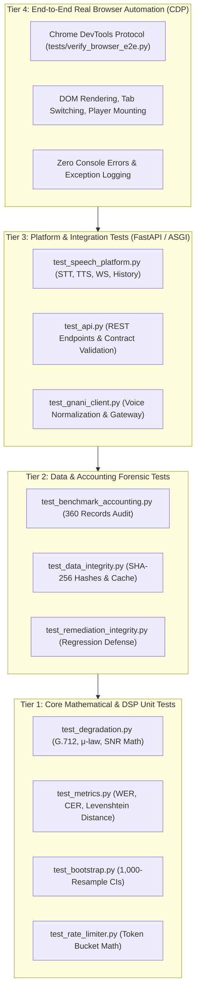

# CallLens — Testing Strategy & Verification Architecture

**Document ID:** `CL-TST-001`  
**Version:** 2.0.0  
**Status:** Canonical Reference  
**Last Updated:** November 2026  
**Author:** Technical Ownership & Engineering Governance  

---

## 1. Quality Assurance Philosophy & Multi-Layer Pyramid

CallLens enforces a multi-tier testing framework designed to prevent regressions across signal processing math, API contracts, database persistence, and client-side browser rendering.



---

## 2. Automated Test Suite Directory (143 Tests)

The test suite consists of **14 test modules** containing **143 tests**, running via `pytest`:

```powershell
.\.venv\Scripts\pytest -q
```

### Module Breakdown & Responsibility

| Module | Test Count | Scope & Verification Target |
| :--- | :--- | :--- |
| `tests/test_api.py` | 20 | REST API endpoints, response schemas, error codes, clip listing. |
| `tests/test_audio_utils.py` | 8 | Audio format validation, WAV header parsing, sampling rate conversion. |
| `tests/test_benchmark_accounting.py` | 7 | Audit of 360 benchmark records, 341 network attempts, cache accounting. |
| `tests/test_bootstrap.py` | 7 | Non-parametric bootstrap resampling, confidence interval bounds, stability. |
| `tests/test_data_integrity.py` | 10 | Hash validation, immutability of historical data, WAL mode integrity. |
| `tests/test_degradation.py` | 13 | G.712 8th-order Butterworth filter, $\mu$-law companding, Gaussian SNR noise. |
| `tests/test_evaluator.py` | 10 | Benchmark evaluation orchestrator, model scoring, caching behavior. |
| `tests/test_gnani_client.py` | 12 | Provider gateway, voice normalization, fail-closed policy, mock engine. |
| `tests/test_history.py` | 9 | SQLite CRUD, pagination, CSV export, atomic cascading deletion. |
| `tests/test_metrics.py` | 10 | Levenshtein distance, WER calculation, CER calculation, edge cases. |
| `tests/test_rate_limiter.py` | 6 | Token bucket capacity, refill math, concurrency race condition resilience. |
| `tests/test_remediation_integrity.py` | 8 | Forensic regression checks, verifying prior bug fixes remain in place. |
| `tests/test_speech_platform.py` | 20 | Dual contract keys, TTS synthesis, STT transcription, WebSocket lifecycle. |
| `tests/test_storage_manager.py` | 3 | Storage directory audit, file count accuracy, orphan asset detection. |
| **Total Passed** | **143** | **100% Pass Rate (0 failures, 0 errors, 0 skips)** |

---

## 3. Real Browser E2E Automation (CDP)

To verify the user interface without third-party heavy dependencies like Cypress or Playwright, CallLens includes a native Chrome DevTools Protocol automation script:
- **Test Script:** `tests/verify_browser_e2e.py`
- **Execution Command:**
  ```powershell
  .\.venv\Scripts\python tests/verify_browser_e2e.py
  ```

### 3.1. Browser Automation Architecture
1. **Chrome Process Launch:** Spawns Google Chrome in headless mode with flags:
   - `--remote-debugging-port=9222`
   - `--headless=new`
   - `--disable-gpu`
   - `--mute-audio`
2. **CDP WebSocket Attachment:** Connects directly to the Chrome DevTools WebSocket target.
3. **Execution Steps:**
   - Navigates to `http://127.0.0.1:8000/`.
   - Listens to `Runtime.consoleAPICalled` and `Runtime.exceptionThrown`.
   - Iterates through all 10 navigation tabs, verifying DOM visibility and element rendering.
   - Triggers STT clip transcription, asserts transcript populates and copy button works.
   - Triggers TTS synthesis with voice `"Pranav"`, asserts audio player loads and duration renders without `NaN` or `undefined`.
   - Navigates to My Recordings, verifies table rendering, verifies `▶ Play` button availability.
   - Navigates to Model Comparison, verifies 360-sample benchmark matrix populates.
   - Asserts **0 fatal console errors** and **0 uncaught exceptions**.

---

## 4. Audio Verification Boundaries

When verifying speech and audio applications, technical governance requires distinguishing four distinct physical and computational layers:

```
┌─────────────────────────────────────────────────────────────┐
│ 1. Audio Generation & Serialization                         │ -> VERIFIED (Automated tests)
│    Backend produces valid 16-bit PCM / WAV byte stream      │
├─────────────────────────────────────────────────────────────┤
│ 2. Disk Storage & Asset Integrity                           │ -> VERIFIED (Hash & storage audit)
│    Audio file successfully written to disk without corrupt  │
├─────────────────────────────────────────────────────────────┤
│ 3. Browser Buffer Decoding & DOM Mounting                   │ -> VERIFIED (Chrome CDP Automation)
│    HTML5 <audio> loads WAV, parses duration, updates UI     │
├─────────────────────────────────────────────────────────────┤
│ 4. Physical Acoustic Audibility                             │ -> PARTIAL (Requires human ear)
│    Sound waves physically emanate from speaker hardware      │
└─────────────────────────────────────────────────────────────┘
```

- **Layers 1, 2, and 3** are 100% verified via automated pytest and CDP scripts.
- **Layer 4** is classified as **PARTIAL** in headless test environments because headless Chrome operates with `--mute-audio`. Physical sound verification is performed during manual human acceptance testing.

---

## 5. Regression Testing & Pre-Commit Protocol

Before any code modification is integrated, the following verification pipeline must execute cleanly:

```powershell
# 1. Run complete automated test suite
.\.venv\Scripts\pytest -q

# 2. Verify git whitespace and format hygiene
git diff --check

# 3. Execute browser CDP automation (with uvicorn server running)
.\.venv\Scripts\python tests/verify_browser_e2e.py

# 4. Verify historical benchmark database remains untouched (exactly 360 rows)
.\.venv\Scripts\python -c "import sqlite3; con = sqlite3.connect('E:/Gnani AI proj/calllens-data/benchmark.db'); print('Rows:', con.execute('SELECT COUNT(*) FROM benchmark_results').fetchone()[0])"
```

