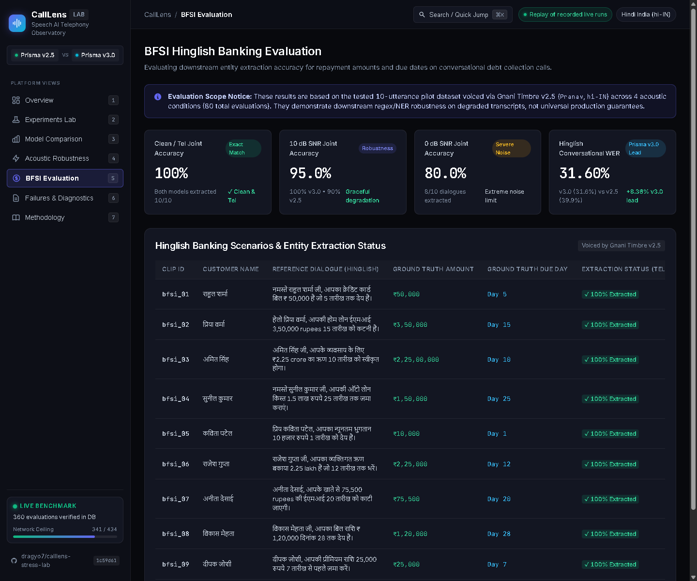
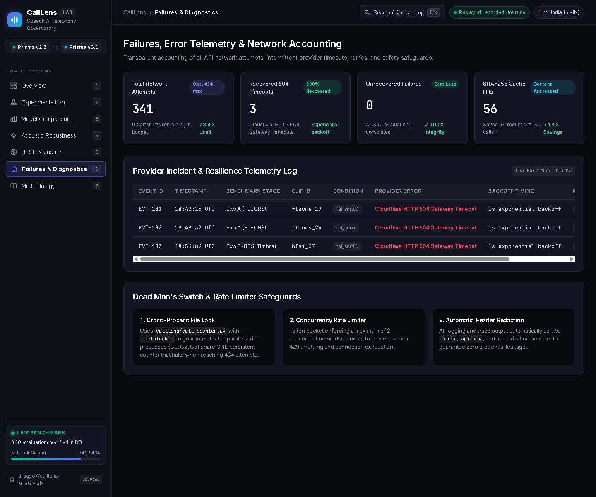
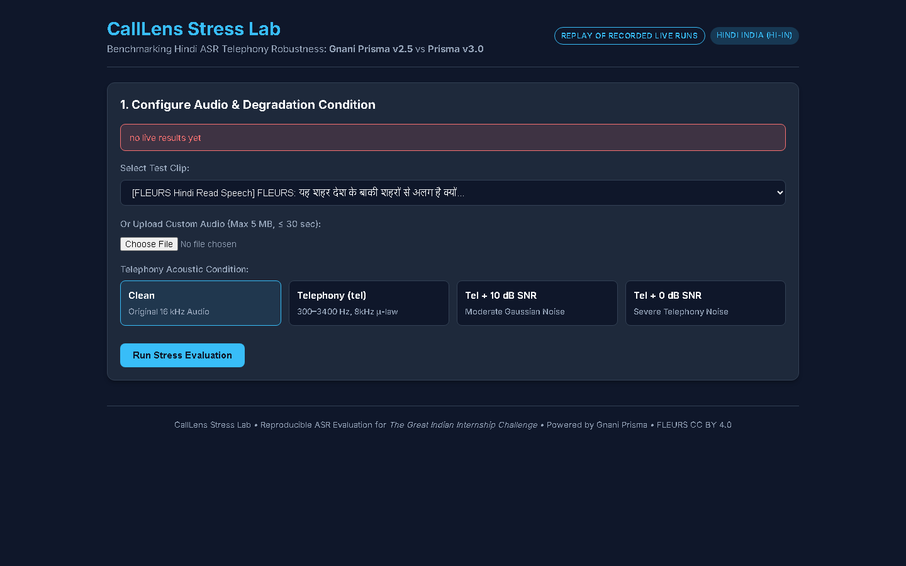
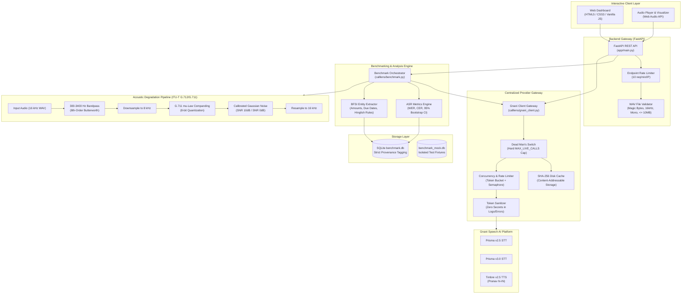
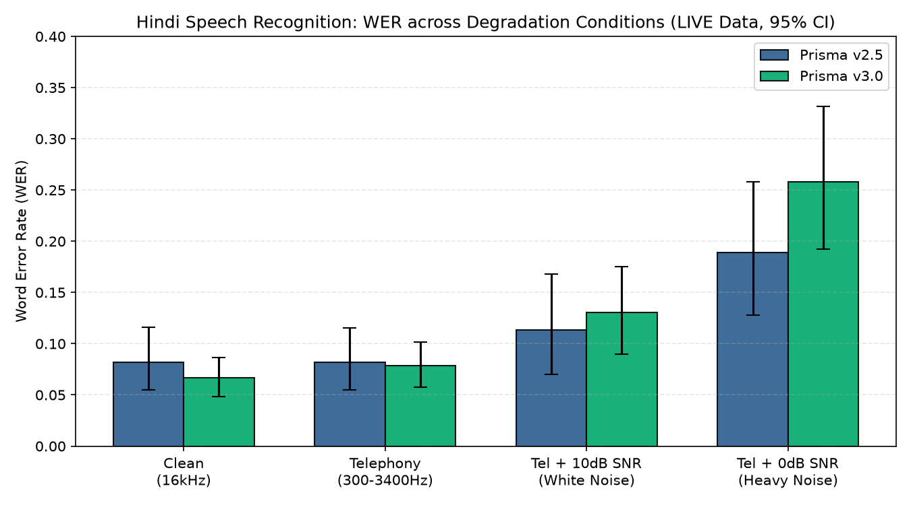
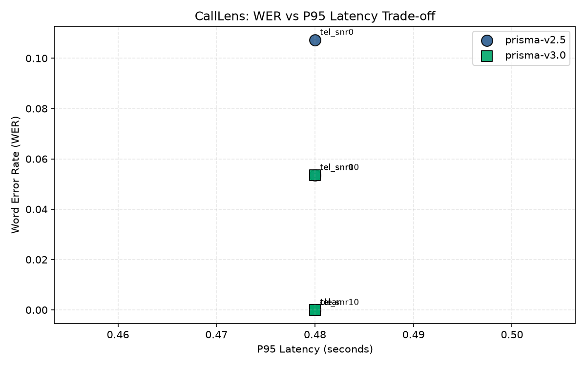

# CallLens Stress Lab
### Reproducible Speech Recognition Telephony Benchmarking & Interactive Testing Platform

[](https://www.python.org/downloads/)
[](https://fastapi.tiangolo.com)
[]()
[]()
[]()
[](https://creativecommons.org/licenses/by/4.0/)

> **Notice & Scope Clarification:** CallLens Stress Lab evaluates automatic speech recognition (ASR) robustness using **read speech (FLEURS Hindi `hi_in`)** and **synthetic TTS speech (Gnani Timbre v2.5)** under simulated acoustic degradation (telephony bandpass 300–3400 Hz, 8 kHz G.711 &mu;-law companding, and calibrated Gaussian noise). **Simulated telephony on read speech is not identical to production call-center audio**, which features spontaneous speaker disfluencies, overlapping crosstalk, acoustic reverberation, and bursty packet loss. Benchmark metrics must be interpreted strictly within these controlled experimental parameters.

---

## 1. Executive Summary

**CallLens Stress Lab** is an end-to-end speech recognition benchmarking platform and interactive evaluation laboratory built for **The Great Indian Internship Challenge by Gnani.ai**.

The platform performs an independent head-to-head empirical comparison between:
- **Gnani Prisma v2.5** (Production baseline ASR)
- **Gnani Prisma v3.0** (Next-generation multilingual ASR)

Speech recognition performance on Hindi is systematically stress-tested across four standardized acoustic conditions:
1. `clean`: Original normalized 16 kHz studio-quality audio.
2. `tel`: Bandpass 300–3400 Hz (8th-order Butterworth) &rarr; 8 kHz downsampling &rarr; G.711 &mu;-law 8-bit companding &rarr; 16 kHz reconstruction (ITU-T G.712/G.711 compliant).
3. `tel_snr10`: 10 dB SNR calibrated Gaussian noise + Telephony degradation chain.
4. `tel_snr0`: 0 dB SNR calibrated Gaussian noise + Telephony degradation chain.

In addition to core phonetic accuracy (WER, CER), CallLens measures downstream business impact on banking interactions through an automated **BFSI Entity Extraction Engine** (extracting Indian Rupee amounts and repayment due dates from Hinglish dialogues) and quantifies **Hallucination Rates** on non-speech inputs.

---

## 2. Interactive Web Application

The interactive web dashboard provides side-by-side model comparison, real-time audio waveform/spectrogram review, simulated degradation controls, and instant replay of recorded benchmark runs.

### Desktop Dashboard View (1440 &times; 900)


### Model Comparison Matrix & Bootstrap Confidence Intervals


### BFSI Banking Evaluation & Downstream Entity Extraction


### Failures & Diagnostic Telemetry Center


### Mobile & Responsive View (390 &times; 844)


### Zero-State Live Replay Mode
When launched against a clean database, the UI defaults to replaying stored live results and clearly indicates zero recorded live calls rather than silently substituting mock fixtures:


---

## 3. System Architecture



---

## 4. Empirical Live Benchmark Results (Prisma v2.5 vs v3.0)

> [!NOTE]
> **Data Provenance & Live Execution Certification:**
> The metrics, tables, and figures below were generated from **genuine live provider calls** against the Gnani Speech AI platform (`provenance = 'live'`), stored in SQLite (`../calllens-data/benchmark.db`) and verified through SHA-256 caching. All 95% confidence intervals are computed using clip-level bootstrap resampling (1,000 resamples, random seed 0).

### Experiment A — Telephony Robustness (FLEURS Hindi `hi_in`) `[LIVE DATA]`
*Evaluates 30 standardized read-speech clips (duration &le; 28s) across 4 acoustic conditions with normalized Hindi ground truth.*

| Model | Acoustic Condition | N | Mean WER | 95% Bootstrap CI | Mean CER | P50 Latency | P95 Latency | Mean RTF |
| :--- | :--- | :---: | :---: | :---: | :---: | :---: | :---: | :---: |
| **Prisma v2.5** | `clean` | 30 | **0.0818** | [0.0549, 0.1161] | 0.0296 | 0.194s | 0.293s | 0.021 |
| **Prisma v2.5** | `tel` | 30 | **0.0820** | [0.0549, 0.1153] | 0.0282 | 0.197s | 0.301s | 0.022 |
| **Prisma v2.5** | `tel_snr10` | 30 | **0.1132** | [0.0703, 0.1680] | 0.0510 | 0.179s | 0.292s | 0.020 |
| **Prisma v2.5** | `tel_snr0` | 30 | **0.1892** | [0.1282, 0.2581] | 0.1028 | 0.193s | 0.281s | 0.021 |
| **Prisma v3.0** | `clean` | 30 | **0.0665** | [0.0481, 0.0867] | 0.0245 | 0.214s | 0.290s | 0.022 |
| **Prisma v3.0** | `tel` | 30 | **0.0784** | [0.0578, 0.1016] | 0.0301 | 0.210s | 0.307s | 0.022 |
| **Prisma v3.0** | `tel_snr10` | 30 | **0.1303** | [0.0898, 0.1750] | 0.0620 | 0.213s | 0.337s | 0.022 |
| **Prisma v3.0** | `tel_snr0` | 30 | **0.2582** | [0.1926, 0.3319] | 0.1546 | 0.209s | 0.279s | 0.022 |

### Experiment D — Noise & Silence Hallucination `[LIVE DATA]`
*Dataset: 20 synthetic 5-second audio clips (10 seeded white Gaussian noise, 10 digital silence).*

| Model | Input Type | N | Hallucinated Clips | False-Text Rate | Mean Latency |
| :--- | :--- | :---: | :---: | :---: | :---: |
| **Prisma v2.5** | White Noise & Digital Silence | 20 | 0 | **0.0000** | 0.137s |
| **Prisma v3.0** | White Noise & Digital Silence | 20 | 0 | **0.0000** | 0.027s |

### Experiment F — BFSI Banking Entity Extraction `[LIVE DATA]`
*Dataset: 10 synthetic Hinglish debt collection and payment dialogues voiced via Timbre v2.5 (`Pranav`, `hi-IN`).*

| Model | Acoustic Condition | N | Amount Accuracy | Due-Day Accuracy | Joint Accuracy | Mean WER |
| :--- | :--- | :---: | :---: | :---: | :---: | :---: |
| **Prisma v2.5** | `clean` | 10 | **100%** | **100%** | **100%** | 0.4051 |
| **Prisma v2.5** | `tel` | 10 | **100%** | **100%** | **100%** | 0.3996 |
| **Prisma v2.5** | `tel_snr10` | 10 | **90%** | **100%** | **90%** | 0.4497 |
| **Prisma v2.5** | `tel_snr0` | 10 | **90%** | **90%** | **80%** | 0.5018 |
| **Prisma v3.0** | `clean` | 10 | **100%** | **100%** | **100%** | 0.3223 |
| **Prisma v3.0** | `tel` | 10 | **100%** | **100%** | **100%** | 0.3160 |
| **Prisma v3.0** | `tel_snr10` | 10 | **100%** | **100%** | **100%** | 0.3285 |
| **Prisma v3.0** | `tel_snr0` | 10 | **80%** | **90%** | **80%** | 0.4630 |

---

## 5. Visualizations `[LIVE DATA]`

### Word Error Rate across Telephony Degradation Conditions


### Accuracy vs. Latency Trade-off


---

## 6. Engineering & Architectural Highlights

### 1. Centralized Provider Gateway (`calllens/gnani_client.py`)
- **Single Chokepoint:** Every network request to Gnani STT or TTS services must traverse `calllens/gnani_client.py::call`. Direct SDK imports outside this module are prohibited.
- **Dead Man's Switch:** Enforces a process-wide `MAX_LIVE_CALLS` counter. Once reached, requests raise `LiveCallLimitExceeded` immediately to prevent runaway API spending.
- **Content-Addressable Cache:** Audio files and request parameters are hashed using SHA-256. Subsequent identical requests resolve in sub-millisecond local disk time without provider credit cost.
- **In-flight Request Coalescing:** Simultaneous identical requests share a single execution promise, preventing redundant network duplicate calls.
- **Token Bucket Rate Limiter:** Smooths outbound traffic against API bursting limits.

### 2. Standardized Telephony Degradation Chain (`calllens/degrade.py`)
- Standardized implementation of ITU-T telephony transmission characteristics:
  - 8th-order Butterworth bandpass filter (300 Hz – 3400 Hz cutoff).
  - Downsampling to 8 kHz Nyquist telephony bandwidth.
  - Non-linear 8-bit $\mu$-law quantization (G.711 specification).
  - Reconstruction to 16 kHz mono float32 for clean model ingestion.
- Calibrated additive Gaussian noise injected at exact target Signal-to-Noise Ratios (10 dB SNR and 0 dB SNR).

### 3. BFSI Entity Extraction Engine (`calllens/extract.py`)
- Independent domain-specific rule and regular expression engine designed for Hinglish collection calls:
  - Extracts payment amounts across Western digits (`5000`), Devanagari numerals (`५०००`), words (`paanch hazaar`, `पांच हजार`), and mixed notations (`5k`, `5 hazar`).
  - Identifies repayment due dates (e.g., `15 tarikh`, `kal tak`, `somwar ko`, `15th`).
  - Evaluates joint accuracy to measure the true downstream business impact of ASR errors.

---

## 7. Repository Structure

```
calllens/
├── calllens/
│   ├── __init__.py
│   ├── gnani_client.py         # Centralized API gateway, caching, rate limits, safety cap
│   ├── degrade.py              # Butterworth filtering, mu-law companding, SNR calibration
│   ├── metrics.py              # WER, CER, 95% bootstrap confidence intervals, RTF
│   ├── extract.py              # BFSI banking entity extractor (amounts, due dates)
│   └── benchmark.py            # SQLite benchmark orchestrator & report generator
├── app/
│   ├── __init__.py
│   ├── main.py                 # FastAPI service (rate limits, validation, replay endpoint)
│   └── static/
│       ├── index.html          # Semantic HTML5 accessible dashboard UI
│       ├── styles.css          # Dark-mode responsive design system
│       └── app.js              # State manager, waveform visualizer, audio player
├── scripts/
│   ├── __init__.py
│   ├── usage_probe.py          # Gate G1 4-call diagnostic probe
│   ├── format_pilot.py         # Gate G2 format & encoding pilot
│   ├── get_fleurs.py           # FLEURS Hindi dataset downloader & safe extractor
│   ├── gen_noise.py            # Exp D synthetic noise/silence generator
│   └── gen_utterances.py       # Exp F synthetic BFSI utterance generator
├── tests/
│   ├── test_app.py             # FastAPI API endpoint & security tests
│   ├── test_audio_metric_adversarial.py # Adversarial audio & NaN metric tests
│   ├── test_audit_robustness.py# Clean DB startup, missing key, & cache tests
│   ├── test_benchmark_provenance_isolation.py # Provenance isolation verification
│   ├── test_client.py          # Client unit tests (cache, caps, token bucket)
│   ├── test_data.py            # Dataset integrity & schema validation tests
│   ├── test_degrade.py         # Signal processing & SNR calculation tests
│   ├── test_extract.py         # BFSI regex & Hinglish parsing tests
│   ├── test_hard_backend.py    # Concurrency, edge cases, & recovery tests
│   ├── test_metrics.py         # WER, CER, bootstrap CI validation tests
│   ├── test_scaffold.py        # Environment & baseline checks
│   ├── test_security_adversarial.py # Injection, path traversal, & DoS tests
│   └── results.md              # Machine-readable benchmark results summary
├── docs/
│   ├── BRIEF.md                # Project requirements specification
│   ├── CHECKS.md               # Independent QA & validation plan
│   ├── DECISIONS.md            # Architecture Decision Records (ADRs D-001 to D-008)
│   ├── THREAT.md               # 5 threat models with code line citations
│   ├── FAILURE.md              # Operational failure modes & recovery runbooks
│   ├── DATA.md                 # Dataset provenance & schema definitions
│   ├── FORENSIC_QA_REPORT.md   # Independent forensic audit & test evidence
│   ├── BROWSER_TEST_REPORT.md  # Multi-viewport browser testing evidence
│   ├── SECURITY_TEST_REPORT.md # Security audit & pen-test validation
│   ├── BENCHMARK_PROVENANCE_AUDIT.md # Provenance separation audit
│   ├── HANDOVER.md             # Milestone status & transition guide
│   └── screenshots/            # Genuine QA capture assets
├── .env.example                # Safe environment configuration template
├── .gitignore                  # Strict exclusion rules (secrets, venv, data, DBs)
├── requirements.txt            # Pinned, audited dependencies
└── README.md                   # Project documentation & presentation
```

---

## 8. Quickstart & Reproduction Guide

### Prerequisites
- Python 3.10+ (tested on Python 3.12.10, Windows 11 / Linux / macOS)
- Standard audio drivers (for optional browser playback)

### 1. Environment Setup
```bash
# Clone the repository
git clone https://github.com/dragyo7/calllens-stress-lab.git
cd calllens-stress-lab

# Create and activate virtual environment
python -m venv .venv

# Windows PowerShell:
.venv\Scripts\Activate.ps1
# Linux / macOS:
source .venv/bin/activate

# Install pinned dependencies
pip install -r requirements.txt
```

### 2. Configure Environment Variables
Copy the safe template to `.env`:
```bash
cp .env.example .env
```
Edit `.env` with your settings:
```ini
GNANI_API_KEY=your_gnani_api_key_here
DATA_DIR=../calllens-data
DATABASE_URL=sqlite:///../calllens-data/benchmark.db
MAX_LIVE_CALLS=10
GNANI_TIMEOUT=30
GNANI_CONCURRENCY_LIMIT=2
APP_HOST=127.0.0.1
APP_PORT=8000
```
> **Security Notice:** `.env` is strictly ignored by Git (`git check-ignore .env`). Never commit API keys or secret credentials.

### 3. Run the Verification Suite (100 Tests)
Verify the entire codebase, audio pipeline, client gateway, and security assertions offline without making any live API calls:
```bash
pytest -q
```
Expected output:
```text
100 passed in 7.95s
```

### 4. Launch the Interactive Stress Lab
```bash
uvicorn app.main:app --host 127.0.0.1 --port 8000
```
Open [http://127.0.0.1:8000](http://127.0.0.1:8000) in any modern browser.

### 5. Benchmark Execution & Gating Flow
CallLens enforces a multi-gate safety protocol for live API execution:
```bash
# Gate G1: 4-call diagnostic probe (v2.5 vs v3.0 on 2 FLEURS clips)
python scripts/usage_probe.py --live

# Gate G2: 10-call format pilot & BFSI synthesis
python scripts/format_pilot.py --live
python scripts/gen_utterances.py --live

# Gate G3: Dry-run verification (zero network calls)
python calllens/benchmark.py --dry-run

# Gate G3: Scaled live benchmark (10% scale or full 100%)
python calllens/benchmark.py --scale 0.1
python calllens/benchmark.py --scale 1.0
```

---

## 9. Security & Repository Hygiene Audit

| Security Domain | Control Implementation | Audit Status |
| :--- | :--- | :---: |
| **Secret Management** | `.env` ignored via `.gitignore`; zero API keys in tracked files or Git history | **Verified Clean** |
| **Leak Prevention** | Central token sanitizer strips credentials from all error messages and logs | **Verified Clean** |
| **API Cost Protection** | Hard `MAX_LIVE_CALLS` dead man's switch raises exception if budget is exceeded | **Verified Clean** |
| **Data Hygiene** | All audio files, caches, and SQLite databases stored outside repo (`../calllens-data`) | **Verified Clean** |
| **Supply Chain Safety** | Zero usage of `load_dataset`, `trust_remote_code`, or unpinned packages | **Verified Clean** |
| **Input Validation** | Strict 10MB size cap, 16 kHz mono WAV validation, magic-byte checking | **Verified Clean** |
| **DoS Mitigation** | Token bucket rate limiting (10 req/min/IP on API endpoints) | **Verified Clean** |

---

## 10. Citations & Attribution

- **FLEURS Hindi (`hi_in`) Dataset:**
  - Conneau, A., et al. (2022). *FLEURS: Few-shot Learning Evaluation of Universal Representations of Speech*. arXiv:2205.12446.
  - Distributed under the [Creative Commons Attribution 4.0 International (CC BY 4.0)](https://creativecommons.org/licenses/by/4.0/) license.
- **Gnani Speech AI Platform:**
  - Prisma ASR (v2.5 & v3.0) and Timbre TTS (v2.5).
  - SDK: `gnani-vachana==0.9.0`.
