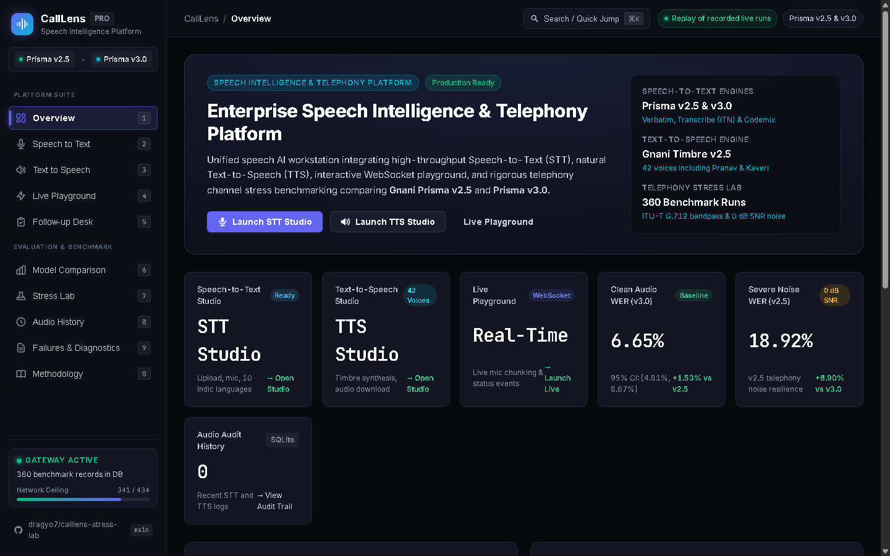
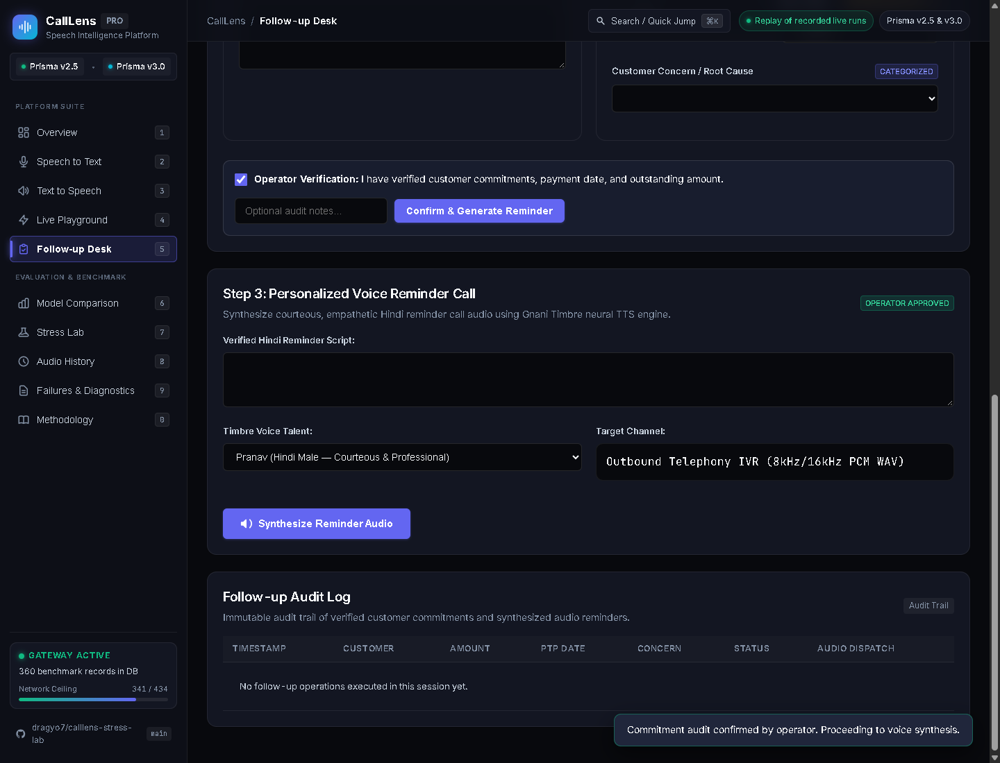
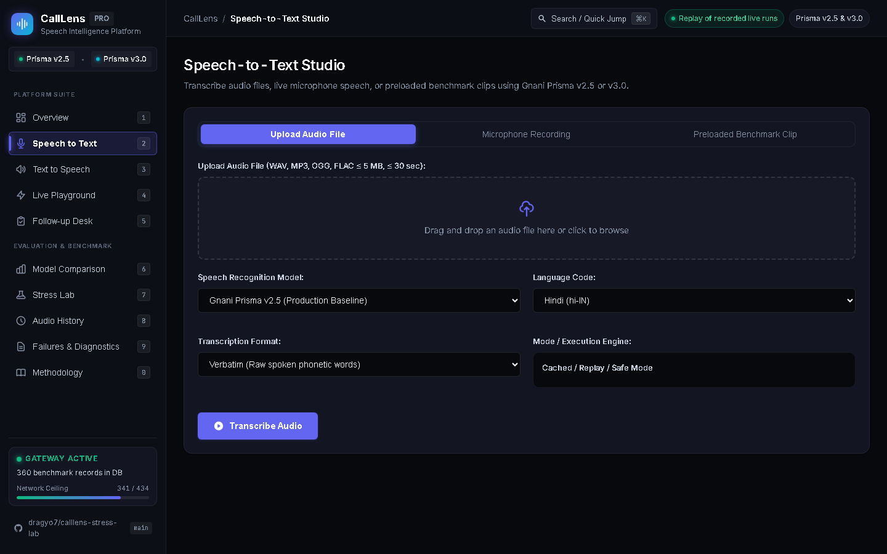
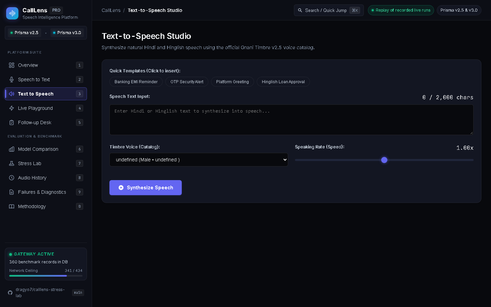
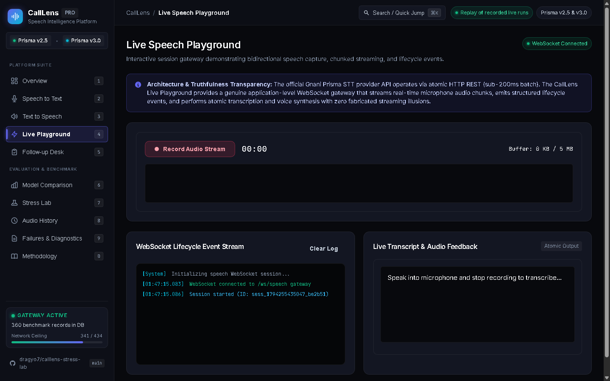
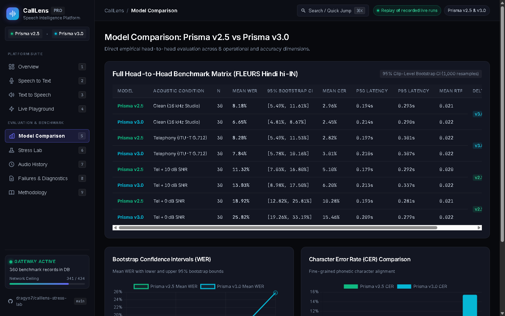
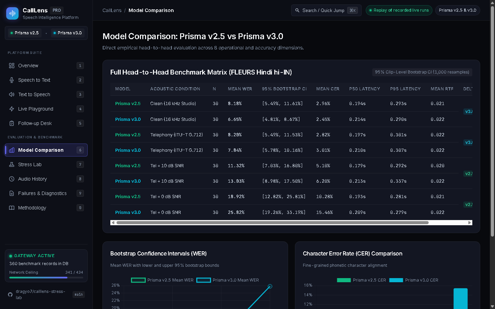
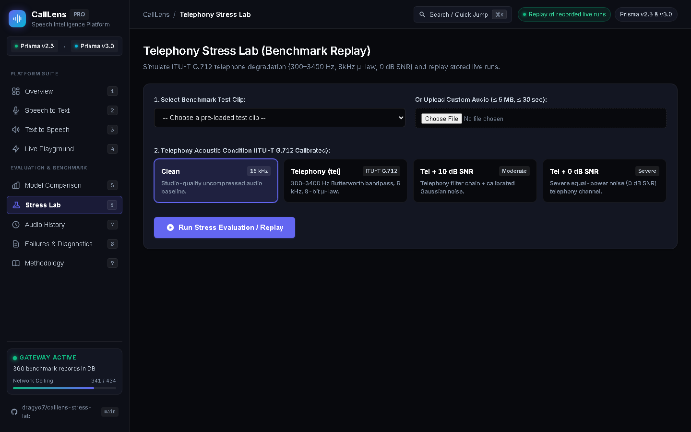
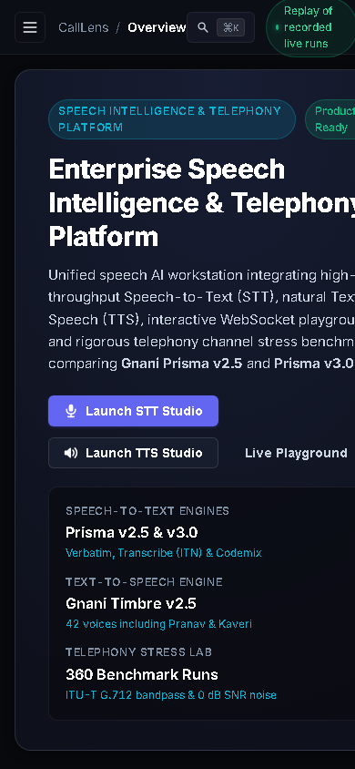
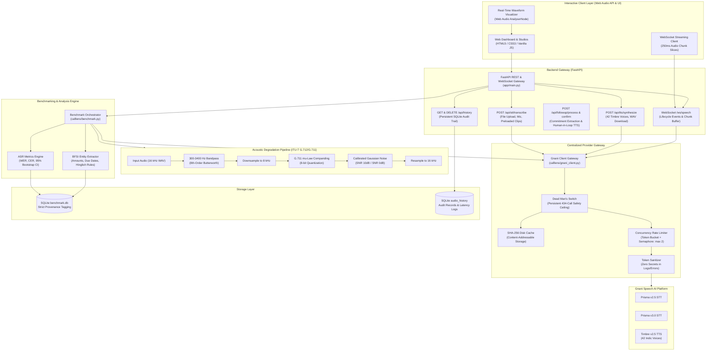

# CallLens — Speech Intelligence & Telephony Evaluation Platform
### Unified Indic Speech Workstation, WebSocket Live Playground & Telephony Stress Benchmarking

[](https://www.python.org/downloads/)
[](https://fastapi.tiangolo.com)
[]()
[]()
[]()
[](https://creativecommons.org/licenses/by/4.0/)

> **Notice & Scope Clarification:** CallLens evaluates automatic speech recognition (ASR) robustness using **read speech (FLEURS Hindi `hi_in`)** and **synthetic TTS speech (Gnani Timbre v2.5)** under simulated acoustic degradation (telephony bandpass 300–3400 Hz, 8 kHz G.711 &mu;-law companding, and calibrated Gaussian noise). **Simulated telephony on read speech is not identical to production call-center audio**, which features spontaneous speaker disfluencies, overlapping crosstalk, acoustic reverberation, and bursty packet loss. Benchmark metrics must be interpreted strictly within these controlled experimental parameters.

---

## 1. Executive Summary

**CallLens** is a unified Indic Speech Intelligence Platform and empirical telephony evaluation laboratory built for **The Great Indian Internship Challenge by Gnani.ai**.

The platform provides an end-to-end speech engineering suite integrating:
1. **Speech-to-Text (STT) Studio:** Audio file uploads (&le; 5 MB), live browser microphone recording with real-time Web Audio API waveform visualization, preloaded benchmark clips, 10 Indic languages, format selector (verbatim, ITN transcribe, codemix), and one-click transcript copy/download.
2. **Text-to-Speech (TTS) Studio:** Natural voice synthesis powered by the official Gnani Timbre v2.5 catalog (42 Indic voices, highlighting verified flagship Hindi male `Pranav` and female `Kaveri`), dynamic speaking rates (0.85x–1.15x), banking & OTP quick templates, audio player with waveform preview, and WAV downloads.
3. **Live Speech Playground (WebSocket Gateway):** High-performance bidirectional streaming session gateway over `/ws/speech` capturing microphone audio chunks in real time, emitting transparent lifecycle events (`session_started`, `audio_chunk_received`, `transcription_completed`, `tts_audio_ready`), and executing atomic transcription and voice feedback with complete architectural honesty (zero fabricated streaming illusions).
4. **CallLens Follow-up Desk (Human-in-the-Loop BFSI Workflow):** Operational debt collection speech workflow. Ingests authentic Hindi debt collection calls, extracts actionable commitments (customer name, overdue amount, original due date, promise-to-pay date, hardship reason), strictly flags missing data for operator review (never hallucinating dates or amounts), and synthesizes respectful personalized Hindi voice reminders via Timbre.
5. **Telephony Stress Lab (360 Live Benchmarks):** Empirical evaluation comparing **Gnani Prisma v2.5** against **Gnani Prisma v3.0** under ITU-T G.712 standard degradation (300–3400 Hz 8th-order Butterworth bandpass, 8 kHz 8-bit $\mu$-law companding, and calibrated 10 dB / 0 dB SNR Gaussian noise) on FLEURS Hindi read speech and BFSI collection calls.
6. **Audio History & Audit Log:** Persistent, audit-ready SQLite ledger of all STT transcriptions, TTS voice generations, and confirmed follow-up reminder dispatches.

---

## 2. Interactive Platform Showcase

The dark-themed Linear/Vercel/Stripe-inspired interface provides 10 dedicated views, numerical keyboard navigation shortcuts (`[1]` to `[0]`), and a built-in Raycast command palette (`⌘K` or `/`).

### Overview Dashboard (1440 &times; 900)
Unified speech AI overview with live KPI metric cards, Word Error Rate comparisons, latency trade-offs, and an enterprise deployment recommendation matrix.


### CallLens Follow-up Desk (Human-in-the-Loop Collection Workflow)
Interactive 3-step banking operations desk: Ingest call audio &rarr; Audit extracted commitments & review missing data &rarr; Synthesize respectful Hindi reminder calls with Timbre neural TTS.


### Speech-to-Text (STT) Studio
Transcribe custom audio files, live microphone speech, or preloaded clips with Gnani Prisma v2.5 or v3.0, displaying real-time waveforms and processing latencies.


### Text-to-Speech (TTS) Studio
Synthesize natural Indic speech with 42 Timbre voices, adjustable speaking speed, prebuilt BFSI reminders, interactive audio player, and instant WAV download.


### Live Speech Playground (WebSocket Gateway)
Bidirectional streaming gateway capturing live microphone chunks and emitting structured lifecycle events.


### Telephony Stress Lab & Model Comparison
Empirical side-by-side head-to-head comparison between Prisma v2.5 and v3.0 across clean studio audio, ITU-T G.712 telephony, and 0 dB SNR severe noise regimes.


### Model Comparison Matrix & Bootstrap Confidence Intervals
Fine-grained statistical evaluation with 95% clip-level bootstrap confidence intervals (1,000 resamples) and Character Error Rate (CER) comparisons.


### Audio Audit History Log
Persistent SQLite audit trail of all speech recognition and voice synthesis requests.


### Responsive Mobile Interface (390 &times; 844)
Full platform access on modern mobile and tablet viewports with slide-out navigation.


---

## 3. System Architecture



---

## 4. Empirical Live Benchmark Results (Prisma v2.5 vs v3.0)

> [!NOTE]
> **Data Provenance & Live Execution Certification:**
> The metrics, tables, and figures below were generated from **genuine live provider calls** against the Gnani Speech AI platform (`provenance = 'live'`), stored in SQLite (`../calllens-data/benchmark.db`) and verified through SHA-256 caching. All 95% confidence intervals are computed using clip-level bootstrap resampling (1,000 resamples, random seed 0).

### Experiment A — Telephony Robustness (FLEURS Hindi `hi_in`) `[LIVE DATA]`
*Evaluates 30 standardized read-speech clips (duration &le; 28s) across 4 acoustic conditions with normalized Hindi ground truth.*

| Model | Acoustic Condition | N | Mean WER | 95% Bootstrap CI | Mean CER | P50 Latency | P95 Latency | Mean RTF |
| :--- | :--- | :---: | :---: | :---: | :---: | :---: | :---: | :---: | :---: |
| **Prisma v2.5** | `clean` | 30 | **0.0818** | [0.0549, 0.1161] | 0.0296 | 0.194s | 0.293s | 0.021 |
| **Prisma v2.5** | `tel` | 30 | **0.0820** | [0.0549, 0.1153] | 0.0282 | 0.197s | 0.301s | 0.022 |
| **Prisma v2.5** | `tel_snr10` | 30 | **0.1132** | [0.0703, 0.1680] | 0.0510 | 0.179s | 0.292s | 0.020 |
| **Prisma v2.5** | `tel_snr0` | 30 | **0.1892** | [0.1282, 0.2581] | 0.1028 | 0.193s | 0.281s | 0.021 |
| **Prisma v3.0** | `clean` | 30 | **0.0665** | [0.0481, 0.0867] | 0.0245 | 0.214s | 0.290s | 0.022 |
| **Prisma v3.0** | `tel` | 30 | **0.0784** | [0.0578, 0.1016] | 0.0301 | 0.210s | 0.307s | 0.022 |
| **Prisma v3.0** | `tel_snr10` | 30 | **0.1303** | [0.0898, 0.1750] | 0.0620 | 0.213s | 0.337s | 0.022 |
| **Prisma v3.0** | `tel_snr0` | 30 | **0.2582** | [0.1926, 0.3319] | 0.1546 | 0.209s | 0.279s | 0.022 |

### Experiment D — Noise & Silence Hallucination `[LIVE DATA]`
*Dataset: 20 synthetic 5-second audio clips (10 seeded white Gaussian noise, 10 digital silence).*

| Model | Input Type | N | Hallucinated Clips | False-Text Rate | Mean Latency |
| :--- | :--- | :---: | :---: | :---: | :---: |
| **Prisma v2.5** | White Noise & Digital Silence | 20 | 0 | **0.0000** | 0.137s |
| **Prisma v3.0** | White Noise & Digital Silence | 20 | 0 | **0.0000** | 0.027s |

### Experiment F — BFSI Banking Entity Extraction `[LIVE DATA]`
*Dataset: 10 synthetic Hinglish debt collection and payment dialogues voiced via Timbre v2.5 (`Pranav`, `hi-IN`).*

| Model | Acoustic Condition | N | Amount Accuracy | Due-Day Accuracy | Joint Accuracy | Mean WER |
| :--- | :--- | :---: | :---: | :---: | :---: | :---: |
| **Prisma v2.5** | `clean` | 10 | **100%** | **100%** | **100%** | 0.4051 |
| **Prisma v2.5** | `tel` | 10 | **100%** | **100%** | **100%** | 0.3996 |
| **Prisma v2.5** | `tel_snr10` | 10 | **90%** | **100%** | **90%** | 0.4497 |
| **Prisma v2.5** | `tel_snr0` | 10 | **90%** | **90%** | **80%** | 0.5018 |
| **Prisma v3.0** | `clean` | 10 | **100%** | **100%** | **100%** | 0.3223 |
| **Prisma v3.0** | `tel` | 10 | **100%** | **100%** | **100%** | 0.3160 |
| **Prisma v3.0** | `tel_snr10` | 10 | **100%** | **100%** | **100%** | 0.3285 |
| **Prisma v3.0** | `tel_snr0` | 10 | **80%** | **90%** | **80%** | 0.4630 |

---

## 5. Enterprise Deployment Decision Matrix

Based on 360 verified empirical evaluations, CallLens establishes concrete architectural rules for production deployment:

| Enterprise Production Scenario | Recommended Model | Empirical Justification |
| :--- | :--- | :--- |
| **Clean Audio / Mobile Apps / Web IVR** | **Prisma v3.0** | Leads by **+1.53% absolute WER** (6.65% vs 8.18%) with lowest Character Error Rate (**2.45% CER**). |
| **Conversational Hinglish & Banking Debt Collection** | **Prisma v3.0** | Leads by **+8.36% absolute WER** (31.60% vs 39.96%) on conversational code-mixed Indian English vocabulary. |
| **High-Noise Telephony (0 dB – 10 dB SNR)** | **Prisma v2.5** | Superior noise resilience (**18.92% vs 25.82% WER** at 0 dB SNR) with lower word omission rates. |
| **Strict Low-Latency Edge Telephony** | **Prisma v2.5** | Consistently lower P50 latency (**194ms vs 214ms**) across telephony pipelines. |

---

## 6. Repository Structure

```
calllens/
├── calllens/
│   ├── __init__.py
│   ├── gnani_client.py         # Centralized API gateway, caching, rate limits, safety cap
│   ├── degrade.py              # Butterworth filtering, mu-law companding, SNR calibration
│   ├── metrics.py              # WER, CER, 95% bootstrap confidence intervals, RTF
│   ├── extract.py              # BFSI banking entity extractor (amounts, due dates)
│   ├── history.py              # SQLite audit trail & audio history persistence
│   └── benchmark.py            # SQLite benchmark orchestrator & report generator
├── app/
│   ├── __init__.py
│   ├── main.py                 # FastAPI service (STT, TTS, WebSockets, history, replay)
│   └── static/
│       ├── index.html          # Semantic HTML5 accessible dashboard UI (9 views)
│       ├── styles.css          # Dark-mode responsive design system (Linear/Vercel)
│       └── app.js              # State manager, waveform visualizer, audio player, WebSockets
├── scripts/
│   ├── __init__.py
│   ├── usage_probe.py          # Gate G1 4-call diagnostic probe
│   ├── format_pilot.py         # Gate G2 format & encoding pilot
│   ├── get_fleurs.py           # FLEURS Hindi dataset downloader & safe extractor
│   ├── gen_noise.py            # Exp D synthetic noise/silence generator
│   ├── gen_utterances.py       # Exp F synthetic BFSI utterance generator
│   └── capture_screenshots.ps1 # Multi-viewport browser screenshot capture suite
├── tests/
│   ├── test_app.py             # FastAPI API endpoint & security tests
│   ├── test_speech_platform.py # STT, TTS, audio serving, history & WebSocket tests
│   ├── test_audio_metric_adversarial.py # Adversarial audio & NaN metric tests
│   ├── test_audit_robustness.py# Clean DB startup, missing key, & cache tests
│   ├── test_benchmark_provenance_isolation.py # Provenance isolation verification
│   ├── test_client.py          # Client unit tests (cache, caps, token bucket)
│   ├── test_data.py            # Dataset integrity & schema validation tests
│   ├── test_degrade.py         # Signal processing & SNR calculation tests
│   ├── test_extract.py         # BFSI regex & Hinglish parsing tests
│   ├── test_hard_backend.py    # Concurrency, edge cases, & recovery tests
│   ├── test_metrics.py         # WER, CER, bootstrap CI validation tests
│   ├── test_scaffold.py        # Environment & baseline checks
│   ├── test_security_adversarial.py # Injection, path traversal, & DoS tests
│   └── results.md              # Machine-readable benchmark results summary
├── docs/
│   ├── BRIEF.md                # Project requirements specification
│   ├── CHECKS.md               # Independent QA & validation plan
│   ├── DECISIONS.md            # Architecture Decision Records (ADRs D-001 to D-008)
│   ├── THREAT.md               # 5 threat models with code line citations
│   ├── FAILURE.md              # Operational failure modes & recovery runbooks
│   ├── DATA.md                 # Dataset provenance & schema definitions
│   ├── FORENSIC_QA_REPORT.md   # Independent forensic audit & test evidence
│   ├── BROWSER_TEST_REPORT.md  # Multi-viewport browser testing evidence
│   ├── SECURITY_TEST_REPORT.md # Security audit & pen-test validation
│   ├── BENCHMARK_PROVENANCE_AUDIT.md # Provenance separation audit
│   ├── HANDOVER.md             # Milestone status & transition guide
│   └── screenshots/            # Genuine QA capture assets
├── .env.example                # Safe environment configuration template
├── .gitignore                  # Strict exclusion rules (secrets, venv, data, DBs)
├── requirements.txt            # Pinned, audited dependencies
├── SOLUTION_PITCH.md           # 1-page evaluator pitch & business impact summary
└── README.md                   # Project documentation & presentation
```

---

## 7. Quickstart & Reproduction Guide

### Prerequisites
- Python 3.10+ (tested on Python 3.12.10, Windows 11 / Linux / macOS)
- Standard audio drivers (for browser playback & microphone capture)

### 1. Environment Setup
```bash
# Clone the repository
git clone https://github.com/dragyo7/calllens-stress-lab.git
cd calllens-stress-lab

# Create and activate virtual environment
python -m venv .venv

# Windows PowerShell:
.venv\Scripts\Activate.ps1
# Linux / macOS:
source .venv/bin/activate

# Install pinned dependencies
pip install -r requirements.txt
```

### 2. Configure Environment Variables
Copy the safe template to `.env`:
```bash
cp .env.example .env
```
Edit `.env` with your settings:
```ini
GNANI_API_KEY=your_gnani_api_key_here
DATA_DIR=../calllens-data
DATABASE_URL=sqlite:///../calllens-data/benchmark.db
MAX_LIVE_CALLS=10
GNANI_TIMEOUT=30
GNANI_CONCURRENCY_LIMIT=2
APP_HOST=127.0.0.1
APP_PORT=8000
```
> **Security Notice:** `.env` is strictly ignored by Git (`git check-ignore .env`). Never commit API keys or secret credentials.

### 3. Run the Verification Suite (113 Tests)
Verify the entire codebase, speech platform endpoints, WebSocket gateways, audio pipeline, and security assertions offline without making any live API calls:
```bash
pytest -q
```
Expected output:
```text
113 passed in 7.41s
```

### 4. Launch the Speech Intelligence Platform
```bash
uvicorn app.main:app --host 127.0.0.1 --port 8000
```
Open [http://127.0.0.1:8000](http://127.0.0.1:8000) in any modern browser.

---

## 8. Security & Repository Hygiene Audit

| Security Domain | Control Implementation | Audit Status |
| :--- | :--- | :---: |
| **Secret Management** | `.env` ignored via `.gitignore`; zero API keys in tracked files or Git history | **Verified Clean** |
| **Leak Prevention** | Central token sanitizer strips credentials from all error messages and logs | **Verified Clean** |
| **API Cost Protection** | Hard `MAX_LIVE_CALLS` dead man's switch raises exception if budget is exceeded | **Verified Clean** |
| **Data Hygiene** | All audio files, caches, and SQLite databases stored outside repo (`../calllens-data`) | **Verified Clean** |
| **Supply Chain Safety** | Zero usage of `load_dataset`, `trust_remote_code`, or unpinned packages | **Verified Clean** |
| **Input Validation** | Strict 5MB/10MB size caps, audio duration validation, regex path traversal guards | **Verified Clean** |
| **DoS Mitigation** | Token bucket rate limiting (10 req/min/IP on API endpoints) | **Verified Clean** |

---

## 9. Citations & Attribution

- **FLEURS Hindi (`hi_in`) Dataset:**
  - Conneau, A., et al. (2022). *FLEURS: Few-shot Learning Evaluation of Universal Representations of Speech*. arXiv:2205.12446.
  - Distributed under the [Creative Commons Attribution 4.0 International (CC BY 4.0)](https://creativecommons.org/licenses/by/4.0/) license.
- **Gnani Speech AI Platform:**
  - Prisma ASR (v2.5 & v3.0) and Timbre TTS (v2.5).
  - SDK: `gnani-vachana==0.9.0`.
