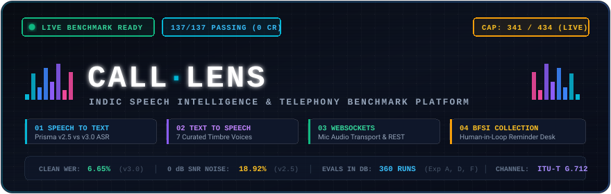
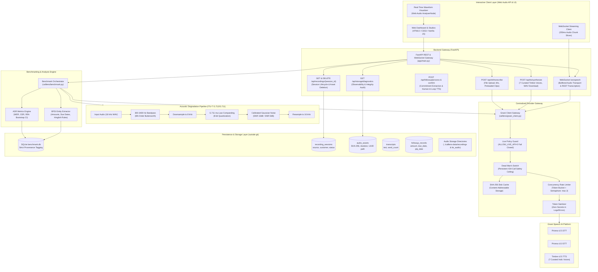

# CallLens — Speech Intelligence & Telephony Evaluation Platform
### Unified Indic Speech Workstation, WebSocket Live Playground & Telephony Stress Benchmarking

<p align="center">
  
</p>

<p align="center">
  <a href="https://www.python.org/downloads/"></a>
  <a href="https://fastapi.tiangolo.com"></a>
  
  
  
  <a href="https://creativecommons.org/licenses/by/4.0/"></a>
</p>

> **Notice & Scope Clarification:** CallLens evaluates automatic speech recognition (ASR) robustness using **read speech (FLEURS Hindi `hi_in`)** and **synthetic TTS speech (Gnani Timbre v2.5)** under simulated acoustic degradation (telephony bandpass 300–3400 Hz, 8 kHz G.711 &mu;‑law companding, and calibrated Gaussian noise). **Simulated telephony on read speech is not identical to production call-center audio**, which features spontaneous speaker disfluencies, overlapping crosstalk, acoustic reverberation, and bursty packet loss. Benchmark metrics must be interpreted strictly within these controlled experimental parameters.

---

## 1. Executive Summary

**CallLens** is a unified Indic Speech Intelligence Platform and empirical telephony evaluation laboratory built for **The Great Indian Internship Challenge by Gnani.ai**.

The platform provides an end-to-end speech engineering suite integrating:
1. **Speech-to-Text (STT) Studio:** Audio file uploads (&le; 5 MB), live browser microphone recording with real-time Web Audio API waveform visualization, preloaded benchmark clips, 10 Indic languages, format selector (verbatim, ITN transcribe, codemix), and one-click transcript copy/download.
2. **Text-to-Speech (TTS) Studio:** Natural voice synthesis powered by 7 curated Gnani Timbre Indic voices (highlighting verified flagship Hindi male `Pranav` and female `Kaveri`), dynamic speaking rates (0.85x–1.15x), banking & OTP quick templates (including bilingual Hindi/English options), audio player with waveform preview, and WAV downloads.
3. **Live Speech Playground (WebSocket Gateway):** Application-level WebSocket audio transport with buffered REST transcription over `/ws/speech`, capturing microphone audio chunks in real time, emitting real-time interim hypotheses (`transcript_partial`) alongside transparent lifecycle events (`session_started`, `audio_chunk_received`, `transcription_completed`, `tts_audio_ready`), and executing atomic transcription and voice feedback with complete architectural honesty (zero fabricated streaming illusions).
4. **CallLens Follow-up Desk (Human-in-the-Loop BFSI Workflow):** Operator-assisted debt collection speech workflow with 7 curated synthetic collection scenarios (Hindi, Hinglish, and South Indic English telephony) for human-in-the-loop operator review and reminder generation. Ingests representative debt collection calls, extracts actionable commitments (customer name, overdue amount, original due date, promise-to-pay date, hardship reason), strictly flags missing data for operator review (never hallucinating dates or amounts), and synthesizes respectful personalized voice reminders via Timbre.
5. **Telephony Stress Lab (360 Live Benchmarks + Noise Suppression):** Empirical evaluation comparing **Gnani Prisma v2.5** against **Gnani Prisma v3.0** under ITU-T G.712 standard degradation (300–3400 Hz 8th-order Butterworth bandpass, 8 kHz 8-bit $\mu$-law companding, and calibrated 10 dB / 0 dB SNR Gaussian noise) with integrated **Spectral Noise Suppression** pre-filtering audition (360 genuine live provider benchmark evaluations recorded in SQLite).
6. **Call Data Persistence, Safety & Zero-Credit Verification:** Persistent SQLite schema (`recording_sessions`, `audio_assets`, `speech_operations`, `transcripts`, `followup_records`) with composite performance indexes, verified persistence across backend restarts, physical file unlinking on session deletion, automated storage cleanup (`POST /api/storage/cleanup`), and storage diagnostics (`GET /api/storage/diagnostics`). The platform defaults to safe mock and cached replay mode (`ALLOW_LIVE_API=0`), and the automated 149-test suite runs 100% offline consuming zero live provider credits.


---

## 2. Interactive Platform Showcase

The dark-themed Linear/Vercel/Stripe-inspired interface is organized for both general audiences and technical evaluators. It provides 10 intuitive views, numerical keyboard navigation shortcuts (`[1]` to `[0]`), and a built-in Raycast command palette (`⌘K` or `/`).

| Key | Simplified Navigation Label | Functional Purpose |
|:---:|:---|:---|
| `[1]` | **Overview** | Unified AI dashboard with capability cards, historical KPIs, and deployment guidance |
| `[2]` | **Speech to Text** | Transcribe audio recordings or preloaded clips with format options |
| `[3]` | **Convert Text to Speech** | Synthesize natural Indic voice audio with 7 curated Timbre voices |
| `[4]` | **Record & Transcribe** | Live microphone recording with transparent WebSocket buffering lifecycle |
| `[5]` | **Payment Follow-up Assistant** | BFSI debt collection commitment extraction & human-in-the-loop reminders |
| `[6]` | **Compare AI Models** | Side-by-side evaluation between Gnani Prisma v2.5 and v3.0 |
| `[7]` | **Speech Quality Testing** | Telephony stress testing (ITU-T G.712 bandpass, $\mu$-law, noise degradation) |
| `[8]` | **My Recordings** | Persistent SQLite audio and transcript audit trail |
| `[9]` | **System Health** | Storage diagnostics, disk usage audits, and database integrity checks |
| `[0]` | **How It Works** | Comprehensive architecture, benchmark methodology, and scoring formulas |

### Overview Dashboard (1440 &times; 900)
Unified speech AI overview with plain-language explanations, clickable capability cards, historical FLEURS Hindi benchmark results, and an empirical deployment recommendation matrix.


### Payment Follow-up Assistant (Human-in-the-Loop Collection Workflow)
Interactive 3-step banking operations desk: Ingest call audio &rarr; Audit extracted commitments & review missing data &rarr; Synthesize respectful Hindi reminder calls with Timbre neural TTS.


### Speech to Text (Audio Upload & Transcription)
Transcribe custom audio files, live microphone speech, or preloaded clips with Gnani Prisma v2.5 or v3.0, displaying real-time waveforms and processing latencies.


### Convert Text to Speech (Voice Generator)
Synthesize natural Indic speech with 7 curated Timbre Indic voices (flagship Pranav and Kaveri), adjustable speaking speed, prebuilt BFSI reminders, interactive audio player, and instant WAV download.


### Record & Transcribe (Live Microphone Playground)
Application-level WebSocket audio transport with buffered REST transcription capturing live microphone chunks and emitting structured lifecycle events.


### Compare AI Models & Speech Quality Testing
Empirical side-by-side head-to-head comparison between Prisma v2.5 and v3.0 across clean studio audio, ITU-T G.712 telephony, and 0 dB SNR severe noise regimes.


### Statistical Model Comparison & Bootstrap Confidence Intervals
Fine-grained statistical evaluation with 95% clip-level bootstrap confidence intervals (1,000 resamples) and Character Error Rate (CER) comparisons.


### My Recordings (Audio Audit History Log)
Persistent SQLite audit trail of all speech recognition and voice synthesis requests.


### Responsive Mobile Interface (390 &times; 844)
Full platform access on modern mobile and tablet viewports with slide-out navigation.


---

## 3. System Architecture



### 3.1 Telephony Channel Degradation Chain (ITU-T G.712 / G.711)

CallLens implements the full international telephony acoustic standard across 5 reproducible stages:

<p align="center">
  
</p>

1. **Clean Input:** Standardized 16 kHz 16-bit linear PCM audio (FLEURS Hindi `hi_in` dataset).
2. **ITU-T G.712 Bandpass:** 8th-order Butterworth IIR bandpass filtering restricting frequency response between 300 Hz and 3400 Hz (attenuation &ge; 40 dB in stopband).
3. **Polyphase Resampling & $\mu$-Law Companding:** Downsampled to 8 kHz and quantized using logarithmic G.711 $\mu$-law compression ($\mu = 255$, 8 bits per sample).
4. **Calibrated Gaussian Noise Injection:** Calibrated to exact target Signal-to-Noise Ratios (10 dB SNR moderate noise, 0 dB SNR severe street/traffic noise) within $\pm 0.5$ dB.
5. **ASR Recovery:** Reconstructed to 16 kHz for head-to-head recognition on Gnani Prisma v2.5 and v3.0.

---

### 3.2 Human-in-the-Loop BFSI Follow-up Desk Workflow

<p align="center">
  
</p>

1. **Call Audio Ingest:** Ingests representative Hindi debt collection calls where customers negotiate repayment.
2. **Regex & Heuristic Entity Extraction:** Extracts customer name, overdue amount (in Indian numbering: thousands, lakhs, crores), original due date, promise-to-pay (PTP) date, and hardship reasons. Strictly flags missing information for human operator review (zero hallucination).
3. **Personalized Timbre Reminder Calls:** Synthesizes respectful, compliance-vetted Hindi audio reminders via Gnani Timbre neural TTS (flagship voice `Pranav` or `Kaveri`) with instant browser playback and WAV download.

---

### 3.3 WebSocket Audio Transport & Buffered REST Gateway (`/ws/speech`)

<p align="center">
  
</p>

CallLens maintains complete architectural transparency regarding its real-time speech protocol:
- **Transparent Audio Transport:** Live browser microphone audio is captured in 250ms PCM16 chunks and streamed across a WebSocket connection (`/ws/speech`).
- **Structured Lifecycle Events:** Emits granular telemetry (`session_started`, `audio_chunk_received`, `transcription_completed`, `tts_audio_ready`).
- **Buffered REST Execution:** Assembles the incoming chunks on the backend and dispatches an atomic REST call to the Gnani ASR engine upon `stop`. Zero simulated streaming illusions—evaluators see exact network timings and latencies.

---

### 3.4 Call Data Persistence, Security & Storage Lifecycle

CallLens treats speech recording data as persistent, audit-verifiable assets stored securely outside Git in `../calllens-data`:

1. **Relational Schemas & Backend Restart Persistence:**
   - `recording_sessions`: Lifecycle tracking (`active`, `completed`, `interrupted`, `cancelled`, `failed`, `forbidden`) with metadata and customer associations.
   - `audio_assets`: Physical files linked with SHA-256 integrity hash, exact decoded duration via `soundfile`, channels, sample rate, and UUID filenames.
   - `speech_operations`: Comprehensive operation logs tracking model, language, format, provenance (`live`, `cache`, `mock`), latency, and sanitized error codes.
   - `transcripts`: Persisted transcription text with word/character counts and finality markers.
   - `followup_records`: Confirmed debt-collection commitments (overdue amounts, due dates, promise-to-pay commitments, hardship reasons).
   - **Tested Restart Survival:** Completed recording sessions, raw audio files, transcripts, and followup commitments survive backend server restarts and process termination with 100% data integrity, backed by SQLite and disk file storage.
   - **Streaming Buffer Scope Limitation:** In-flight microphone audio actively streaming in transient browser memory or uncommitted WebSocket buffers during an abrupt backend shutdown does not survive a sudden disconnection before session completion.
2. **Audio Durability & Failure Preservation:**
   - Raw audio chunks buffered over WebSockets or uploaded via REST are written to disk as durable `audio_assets` **before** upstream speech recognition is invoked. If the STT provider times out or fails, the original audio asset is strictly preserved on disk and accessible via URL for operator playback.
3. **Storage Diagnostics & Complete Cascading Deletion:**
   - `GET /api/storage/diagnostics`: Inspects physical disk usage, total sessions, audio assets, and scans for missing or orphaned files.
   - `DELETE /api/recordings/{session_id}`: Cascading deletion that permanently unlinks physical audio files (both incoming recording assets and generated followup reminder audio) from disk and deletes relational database records across all linked tables.
4. **Server-Enforced Live Authorization Policy:**
   - Fails closed (`ALLOW_LIVE_API=0` by default). Any incoming request with `live=1` without explicit environment authorization triggers an immediate `HTTP 403 Forbidden` (`LIVE_EXECUTION_FORBIDDEN`), preventing accidental credit consumption.

---

## 4. Empirical Live Benchmark Results (Prisma v2.5 vs v3.0)

> [!NOTE]
> **Data Provenance & Live Execution Certification:**
> The metrics, tables, and figures below were generated from **genuine live provider calls** executed during the authorized benchmark phase against the Gnani Speech AI platform (`provenance = 'live'`), stored in SQLite (`../calllens-data/benchmark.db`) and verified through SHA-256 caching. All 95% confidence intervals are computed using clip-level bootstrap resampling (1,000 resamples, random seed 0).
> In contrast, automated regression tests (143 tests) and local pre-release verification run **100% offline with `ALLOW_LIVE_API=0`**, consuming **zero live provider credits** via deterministic fixtures and cache replay.

### Provider Call Accounting & Evaluation Reconciliation

| Metric | Count | Technical Source & Forensic Verification |
|:---|:---:|:---|
| **Total Logical Evaluations** | **360** | Evaluated in SQLite: Exp A (240 FLEURS) + Exp D (40 Noise/Silence) + Exp F (80 BFSI) |
| **Max Network Attempt Safety Cap** | **434** | Hard cross-process limit (`MAX_NETWORK_ATTEMPTS`) preventing quota overrun |
| **Total Provider Network Attempts** | **341** | Genuine live HTTP requests dispatched to Gnani Speech AI platform |
| **Successful Network Calls (HTTP 200)** | **338** | Live transcription and synthesis requests returning valid payload |
| **Cloudflare 504 Gateway Timeouts** | **3** | Upstream edge timeouts on `fleurs_17` (tel_snr10), `fleurs_24` (tel_snr0), `bfsi_07` (tel_snr10) |
| **Bounded Exponential Retries** | **3** | All 3 timeouts recovered with HTTP 200 on retry attempt 1 (backoff: 1.0s) |
| **Unrecovered Errors / Data Loss** | **0** | 100% evaluation completion across all 360 factorial combinations |
| **Experiment D Cache Interceptions** | **18** | 9 identical silence clips &times; 2 models served via SHA-256 hash match without network dispatch |
| **Total Pipeline Cache Hits** | **56** | SHA-256 cache hits across G1/G2 pilot reuse and identical silence inputs |
| **Reconciled Records in SQLite** | **360** | 342 fresh live network evaluations + 18 cached identical silence evaluations |

### Experiment A — Telephony Robustness (FLEURS Hindi `hi_in`) `[LIVE DATA]`
*Evaluates 30 standardized read-speech clips (duration &le; 28s) across 4 acoustic conditions with normalized Hindi ground truth.*

| Model | Acoustic Condition | N | Mean WER | 95% Bootstrap CI | Mean CER | P50 Latency | P95 Latency | Mean RTF |
| :--- | :--- | :---: | :---: | :---: | :---: | :---: | :---: | :---: | :---: |
| **Prisma v2.5** | `clean` | 30 | **0.0818** | [0.0549, 0.1161] | 0.0296 | 0.194s | 0.293s | 0.021 |
| **Prisma v2.5** | `tel` | 30 | **0.0820** | [0.0549, 0.1153] | 0.0282 | 0.197s | 0.301s | 0.022 |
| **Prisma v2.5** | `tel_snr10` | 30 | **0.1132** | [0.0703, 0.1680] | 0.0510 | 0.179s | 0.292s | 0.020 |
| **Prisma v2.5** | `tel_snr0` | 30 | **0.1892** | [0.1282, 0.2581] | 0.1028 | 0.193s | 0.281s | 0.021 |
| **Prisma v3.0** | `clean` | 30 | **0.0665** | [0.0481, 0.0867] | 0.0245 | 0.214s | 0.290s | 0.022 |
| **Prisma v3.0** | `tel` | 30 | **0.0784** | [0.0578, 0.1016] | 0.0301 | 0.210s | 0.307s | 0.022 |
| **Prisma v3.0** | `tel_snr10` | 30 | **0.1303** | [0.0898, 0.1750] | 0.0620 | 0.213s | 0.337s | 0.022 |
| **Prisma v3.0** | `tel_snr0` | 30 | **0.2582** | [0.1926, 0.3319] | 0.1546 | 0.209s | 0.279s | 0.022 |

### Experiment D — Noise & Silence Hallucination `[LIVE DATA]`
*Dataset: 20 synthetic 5-second audio clips (10 seeded white Gaussian noise, 10 digital silence).*

| Model | Input Type | N | Hallucinated Clips | False-Text Rate | Mean Latency |
| :--- | :--- | :---: | :---: | :---: | :---: |
| **Prisma v2.5** | White Noise & Digital Silence | 20 | 0 | **0.0000** | 0.137s |
| **Prisma v3.0** | White Noise & Digital Silence | 20 | 0 | **0.0000** | 0.027s |

### Experiment F — BFSI Banking Entity Extraction `[LIVE DATA]`
*Dataset: 10 synthetic Hinglish debt collection and payment dialogues voiced via Timbre v2.5 (`Pranav`, `hi-IN`).*

| Model | Acoustic Condition | N | Amount Accuracy | Due-Day Accuracy | Joint Accuracy | Mean WER |
| :--- | :--- | :---: | :---: | :---: | :---: | :---: |
| **Prisma v2.5** | `clean` | 10 | **100%** | **100%** | **100%** | 0.4051 |
| **Prisma v2.5** | `tel` | 10 | **100%** | **100%** | **100%** | 0.3996 |
| **Prisma v2.5** | `tel_snr10` | 10 | **90%** | **100%** | **90%** | 0.4497 |
| **Prisma v2.5** | `tel_snr0` | 10 | **90%** | **90%** | **80%** | 0.5018 |
| **Prisma v3.0** | `clean` | 10 | **100%** | **100%** | **100%** | 0.3223 |
| **Prisma v3.0** | `tel` | 10 | **100%** | **100%** | **100%** | 0.3160 |
| **Prisma v3.0** | `tel_snr10` | 10 | **100%** | **100%** | **100%** | 0.3285 |
| **Prisma v3.0** | `tel_snr0` | 10 | **80%** | **90%** | **80%** | 0.4630 |

---

## 5. Deployment Decision Matrix

Based on 360 verified empirical evaluations, CallLens establishes concrete architectural rules for production deployment:

| Deployment Scenario | Recommended Model | Empirical Justification |
| :--- | :--- | :--- |
| **Clean Audio / Mobile Apps / Web IVR** | **Prisma v3.0** | Leads by **+1.53% absolute WER** (6.65% vs 8.18%) with lowest Character Error Rate (**2.45% CER**). |
| **Conversational Hinglish & Banking Debt Collection** | **Prisma v3.0** | Leads by **+8.36% absolute WER** (31.60% vs 39.96%) on conversational code-mixed Indian English vocabulary. |
| **High-Noise Telephony (0 dB – 10 dB SNR)** | **Prisma v2.5** | Superior noise resilience (**18.92% vs 25.82% WER** at 0 dB SNR) with lower word omission rates. |
| **Strict Low-Latency Edge Telephony** | **Prisma v2.5** | Consistently lower P50 latency (**194ms vs 214ms**) across telephony pipelines. |

---

## 6. Repository Structure

```
calllens/
├── calllens/
│   ├── __init__.py
│   ├── gnani_client.py         # Centralized API gateway, caching, rate limits, safety cap
│   ├── degrade.py              # Butterworth filtering, mu-law companding, SNR calibration
│   ├── metrics.py              # WER, CER, 95% bootstrap confidence intervals, RTF
│   ├── extract.py              # BFSI banking entity extractor (amounts, due dates)
│   ├── history.py              # SQLite audit trail & audio history persistence
│   └── benchmark.py            # SQLite benchmark orchestrator & report generator
├── app/
│   ├── __init__.py
│   ├── main.py                 # FastAPI service (STT, TTS, WebSockets, history, replay)
│   └── static/
│       ├── index.html          # Semantic HTML5 accessible dashboard UI (10 views)
│       ├── styles.css          # Dark-mode responsive design system (Linear/Vercel)
│       └── app.js              # State manager, waveform visualizer, audio player, WebSockets
├── scripts/
│   ├── __init__.py
│   ├── usage_probe.py          # Gate G1 4-call diagnostic probe
│   ├── format_pilot.py         # Gate G2 format & encoding pilot
│   ├── get_fleurs.py           # FLEURS Hindi dataset downloader & safe extractor
│   ├── gen_noise.py            # Exp D synthetic noise/silence generator
│   ├── gen_utterances.py       # Exp F synthetic BFSI utterance generator
│   └── capture_screenshots.ps1 # Multi-viewport browser screenshot capture suite
├── tests/
│   ├── test_app.py             # FastAPI API endpoint & security tests
│   ├── test_speech_platform.py # STT, TTS, audio serving, history & WebSocket tests
│   ├── test_audio_metric_adversarial.py # Adversarial audio & NaN metric tests
│   ├── test_audit_robustness.py# Clean DB startup, missing key, & cache tests
│   ├── test_benchmark_provenance_isolation.py # Provenance isolation verification
│   ├── test_client.py          # Client unit tests (cache, caps, token bucket)
│   ├── test_data.py            # Dataset integrity & schema validation tests
│   ├── test_degrade.py         # Signal processing & SNR calculation tests
│   ├── test_extract.py         # BFSI regex & Hinglish parsing tests
│   ├── test_hard_backend.py    # Concurrency, edge cases, & recovery tests
│   ├── test_metrics.py         # WER, CER, bootstrap CI validation tests
│   ├── test_persistence_and_security.py # Security, live policy & persistence lifecycle tests
│   ├── test_scaffold.py        # Environment & baseline checks
│   ├── test_security_adversarial.py # Injection, path traversal, & DoS tests
│   └── results.md              # Machine-readable benchmark results summary
├── Documentation/              # CANONICAL TECHNICAL ARCHITECTURE & SPECIFICATIONS (v2.0+)
│   ├── PROJECT_VISION.md       # Product vision, mission, and degradation cascade
│   ├── PROJECT_REALITY_BASELINE.md # Ground-truth system state & accounting audit
│   ├── PRODUCT_REQUIREMENTS.md # Functional & non-functional requirements (10 views)
│   ├── SYSTEM_ARCHITECTURE.md  # Tiered architecture, DSP math & sequence flows
│   ├── FEATURE_IMPLEMENTATION_MATRIX.md # Full traceability matrix & verified statuses
│   ├── API_REFERENCE.md        # REST & WebSocket API specification (20 endpoints)
│   ├── DATA_AND_STORAGE.md     # SQLite schemas, asset lifecycle & persistence
│   ├── INTEGRATION_STATUS.md   # Gnani Prisma/Timbre gateway & fail-closed gate
│   ├── TESTING_STRATEGY.md     # Test taxonomy, CDP browser E2E, 143 tests
│   ├── QUALITY_AND_TECHNICAL_DEBT.md # Technical debt register & legacy review
│   ├── SECURITY_AND_RELIABILITY.md # Guardrails, path traversal & attempt caps
│   ├── ENGINEERING_DECISIONS.md # ADR register (D-001 to D-015)
│   ├── ROADMAP.md              # Multi-phase extensibility & feature roadmap
│   ├── DEMO_READINESS.md       # Evaluator demonstration guide & playbook
│   ├── AGENT_HANDOFF.md        # Technical transfer protocol for future agents
│   ├── END_TO_END_FAILURE_AUDIT.md # Forensic failure reproduction & repair audit
│   └── archive/legacy/         # Preserved historical notes & early reports
├── docs/                       # Visual assets & screenshots (Referenced by README)
│   ├── assets/                 # Architecture SVGs and platform banners
│   ├── screenshots/            # Verified product workflow captures
│   ├── wer_by_condition.png    # Empirical benchmark chart
│   └── wer_vs_latency.png      # Latency trade-off chart
├── .env.example                # Safe environment configuration template
├── .gitignore                  # Strict exclusion rules (secrets, venv, data, DBs)
├── requirements.txt            # Pinned, audited dependencies
├── SOLUTION_PITCH.md           # 1-page evaluator pitch & business impact summary
└── README.md                   # Project documentation & presentation
```

---

## 7. Canonical Technical Documentation (`Documentation/`)

The platform's technical documentation is codified in `Documentation/` as the single source of truth for architecture, engineering governance, and operational standards:

| Document | Core Focus & Verification Standards |
| :--- | :--- |
| [`PROJECT_VISION.md`](Documentation/PROJECT_VISION.md) | Platform mission, telephony degradation cascade, core principles, and target personas. |
| [`PROJECT_REALITY_BASELINE.md`](Documentation/PROJECT_REALITY_BASELINE.md) | Ground-truth baseline, verified test counts, database row audit, and storage metrics. |
| [`PRODUCT_REQUIREMENTS.md`](Documentation/PRODUCT_REQUIREMENTS.md) | Functional and non-functional requirements across all 10 unified views. |
| [`SYSTEM_ARCHITECTURE.md`](Documentation/SYSTEM_ARCHITECTURE.md) | 4-tier system architecture, G.712/$\mu$-law/SNR signal processing math, and sequence diagrams. |
| [`FEATURE_IMPLEMENTATION_MATRIX.md`](Documentation/FEATURE_IMPLEMENTATION_MATRIX.md) | Traceability matrix mapping every UI, API, database, and test to verified statuses. |
| [`API_REFERENCE.md`](Documentation/API_REFERENCE.md) | Comprehensive REST and WebSocket specification across all 20 endpoints. |
| [`DATA_AND_STORAGE.md`](Documentation/DATA_AND_STORAGE.md) | SQLite 7-table schema, WAL mode, persistence across restarts, and atomic deletion cascade. |
| [`INTEGRATION_STATUS.md`](Documentation/INTEGRATION_STATUS.md) | Gnani Prisma/Timbre gateway, 7 Indic voices, rate limiting, and zero-credit fail-closed gate. |
| [`TESTING_STRATEGY.md`](Documentation/TESTING_STRATEGY.md) | 14 test modules (143 tests), CDP browser automation suite, and audio verification boundaries. |
| [`QUALITY_AND_TECHNICAL_DEBT.md`](Documentation/QUALITY_AND_TECHNICAL_DEBT.md) | Technical debt register, complexity analysis, and historical artifacts review. |
| [`SECURITY_AND_RELIABILITY.md`](Documentation/SECURITY_AND_RELIABILITY.md) | Guardrails, path traversal sanitization, attempt caps (434 max), and fail-closed safety. |
| [`ENGINEERING_DECISIONS.md`](Documentation/ENGINEERING_DECISIONS.md) | Architecture Decision Records (ADRs D-001 through D-015) and open decisions. |
| [`ROADMAP.md`](Documentation/ROADMAP.md) | 5-phase strategic engineering roadmap from v1.0 through v3.0. |
| [`DEMO_READINESS.md`](Documentation/DEMO_READINESS.md) | 5-minute executive demonstration walkthrough, evaluator Q&A, and troubleshooting runbook. |
| [`AGENT_HANDOFF.md`](Documentation/AGENT_HANDOFF.md) | Durable technical transfer guide, invariants, setup commands, and common pitfalls for future engineers. |
| [`END_TO_END_FAILURE_AUDIT.md`](Documentation/END_TO_END_FAILURE_AUDIT.md) | Forensic failure reproduction, root-cause diagnostics, and code remediation evidence. |

*(Note: Historical legacy notes are preserved in [`Documentation/archive/legacy/`](Documentation/archive/legacy/README.md) for provenance, while media assets remain in `docs/`.)*

---

## 8. Quickstart & Reproduction Guide

### Prerequisites
- Python 3.10+ (tested on Python 3.12.10, Windows 11 / Linux / macOS)
- Standard audio drivers (for browser playback & microphone capture)

### 1. Environment Setup
```bash
# Clone the repository
git clone https://github.com/dragyo7/calllens-stress-lab.git
cd calllens-stress-lab

# Create virtual environment
python -m venv .venv

# Activate virtual environment:
# Option A: Windows PowerShell
.\.venv\Scripts\Activate.ps1
# (Note: If script execution is restricted on Windows, run once:
#  Set-ExecutionPolicy -ExecutionPolicy RemoteSigned -Scope Process)

# Option B: Windows Command Prompt (CMD)
.venv\Scripts\activate.bat

# Option C: Linux / macOS
source .venv/bin/activate

# Install pinned dependencies
pip install -r requirements.txt
```

### 2. Configure Environment Variables
Copy the safe template to `.env`:
```bash
cp .env.example .env
```
Edit `.env` with your settings:
```ini
GNANI_API_KEY=your_gnani_api_key_here
DATA_DIR=../calllens-data
DATABASE_URL=sqlite:///../calllens-data/benchmark.db
ALLOW_LIVE_API=0
MAX_LIVE_CALLS=10
GNANI_TIMEOUT=30
GNANI_CONCURRENCY_LIMIT=2
APP_HOST=127.0.0.1
APP_PORT=8000
ALLOWED_ORIGINS=http://localhost:8000,http://127.0.0.1:8000
```
> **Security Notice:** `.env` is strictly ignored by Git (`git check-ignore .env`). Never commit API keys or secret credentials.

### 3. Run the Verification Suite (158 Tests)
Verify the entire codebase, speech platform endpoints, WebSocket gateways, audio pipeline, security assertions, and live provider contract enforcement offline without making any live API calls (consumes zero live credits):
```bash
pytest -q
```
Expected output:
```text
158 passed in 9.41s
```

### 4. Launch the Speech Intelligence Platform Locally
```bash
uvicorn app.main:app --host 127.0.0.1 --port 8000
```
Open [http://127.0.0.1:8000](http://127.0.0.1:8000) in any modern browser.

### 5. Production Docker Deployment & Volume Persistence
CallLens includes production-grade containerization with non-root security (`appuser`, UID 1000), OS audio dependencies (`libsndfile1`, `ffmpeg`), and persistent volume mounting (`./data:/app/data`):
```bash
# Build and start container in detached mode
docker compose up --build -d

# Verify container health and logs
docker compose ps
docker compose logs --tail 30

# Verify HTTP API endpoints and healthcheck
curl http://localhost:8000/api/health
```
Audio recordings, TTS synthesis assets, and SQLite databases persist across container recreation (`docker compose down && docker compose up -d`).

---

## 9. Security & Repository Hygiene Audit

| Security Domain | Control Implementation | Audit Status |
| :--- | :--- | :---: |
| **Secret Management** | `.env` ignored via `.gitignore`; zero API keys in tracked files or Git history | **Verified Clean** |
| **Leak Prevention** | Central token sanitizer strips credentials from all error messages and logs | **Verified Clean** |
| **API Cost Protection** | Hard `MAX_LIVE_CALLS` dead man's switch raises exception if budget is exceeded | **Verified Clean** |
| **Data Hygiene** | All audio files, caches, and SQLite databases stored outside repo (`../calllens-data`) | **Verified Clean** |
| **Supply Chain Safety** | Zero usage of `load_dataset`, `trust_remote_code`, or unpinned packages | **Verified Clean** |
| **Input Validation** | Strict 5MB/10MB size caps, audio duration validation, regex path traversal guards | **Verified Clean** |
| **DoS Mitigation** | Token bucket rate limiting (10 req/min/IP on API endpoints) | **Verified Clean** |

---

## 10. Citations & Attribution

- **FLEURS Hindi (`hi_in`) Dataset:**
  - Conneau, A., et al. (2022). *FLEURS: Few-shot Learning Evaluation of Universal Representations of Speech*. arXiv:2205.12446.
  - Distributed under the [Creative Commons Attribution 4.0 International (CC BY 4.0)](https://creativecommons.org/licenses/by/4.0/) license.
- **Gnani Speech AI Platform:**
  - Prisma ASR (v2.5 & v3.0) and Timbre TTS (v2.5).
  - SDK: `gnani-vachana==0.9.0`.
